# 开放能力原稿保留区

来源：[当前大稿](https://bytedance.larkoffice.com/wiki/XfuUwc7UXiXsg6kx33Uc343UnfR)，开放能力章节，读取版本 87。

这是保留副本，不是优化正文。原文数字、结论、状态、错字和代码不静默改写；原图保存于同目录资源文件夹，画板在本地为预览并附原入口。3 个链接预览保留原文定位；录屏保留原文入口。字数口径和证据问题见优化方案。

---


# 3.1 VIMO CLI/Open API 开放能力


## 3.1.1 背景

**业务诉求**


> [vimo CLI诉求](https://bytedance.larkoffice.com/wiki/YjuJwZTydiZMcvko833cmlJFngg)
> 
> 
> [原文链接预览（回原位置查看）](https://bytedance.larkoffice.com/docx/LQ4Od0Od6ooDUZxdpX1cmo45nNf#CjwydtBl7o27EUxm7sZcP4eunWb)
> 
> 
> [原文链接预览（回原位置查看）](https://bytedance.larkoffice.com/docx/LQ4Od0Od6ooDUZxdpX1cmo45nNf#Jfo2dnIBLoZZNFxVkl8cP9JSnhd)
> 
> 其他类似需求不赘述

**外部环境**

lark-cli、bytedcli 已将业务操作组织成命令，Agent 可以读取说明、按任务调用，并根据结果继续执行。VIMO 可以采用同样的方式：已有操作能够覆盖的任务，由 Agent 组织执行，减少为不同任务单独开发页面入口或编写专用脚本的工作。

**建设方向**

VIMO 已有一版[素材 OpenAPI](https://bytedance.larkoffice.com/wiki/Q0U5w7MS5ikSOLkv7YdcKd9AnVX)，部分业务操作已经可以由程序调用。面向 Agent 和更多业务接入，旧版仍有以下限制：


| 旧版限制 | 具体问题 |
| --- | --- |
| 使用说明 | 接口用途和参数集中在文档中，调用方需要自行查阅并编写调用代码，尚未提供供 Agent 直接调用的命令入口及任务说明。 |
| 运维支持 | 缺少调用频率限制，权限需要联系管理员手动开通。 |
| 认证接入 | 调用方需要自行计算请求签名，接入脚本还要处理凭证配置。 |

在复用已有业务处理的基础上，业务能力分为两个建设方向：


- **开放现有功能**：将查询、配置、分类维护等功能开放为接口和命令，复用原有业务规则，让 Agent、脚本及其他业务服务直接调用。
- **面向 Agent 开发新功能**：针对原页面没有覆盖的需求，补充批量处理、按指定素材或分类发布等能力，直接通过 Agent 提供给用户，不必先开发对应页面。


## 3.1.2 产出


### 3.1.2.1 能力交付


【原文高亮块】

素材开放覆盖 **素材新增编辑 · 分级 · 屏蔽 · 面板与分类 · 发布 · 实验 · 下发控制 · 配置与运维8 类业务、共61 个接口**。


【/原文高亮块】


| **交付物** | **交付内容** | **使用方式** |
| --- | --- | --- |
| OpenAPI | 查询、配置、批量处理和发布操作，以及配套权限。重点补充分级详情、分类关系维护、批量分类配置、3 个发布接口和下发调整。 | 脚本、服务和 Agent 直接调用；不同入口复用相同业务规则。 |
| vimocli | 承接业务命令，统一站点、身份、参数处理和结果输出。 | 人工终端、自动化脚本和 Agent 使用同一套命令。 |
| 用户 Skill | 配套任务入口、参数说明、操作确认与结果检查方法。 | Agent 按任务加载说明，把查询、修改、发布等操作组织起来。 |


### 3.1.2.2 业务支持


| **业务场景** | **应用与成效** |
| --- | --- |
| 批量查询 | 运营 符梦义 使用 Agent 调用现有素材查询能力，核查约**150 个老特效 key**的上下线状态，替代逐项搜索与整理，**无需新增批量搜索入口**。<br/><br/><br/>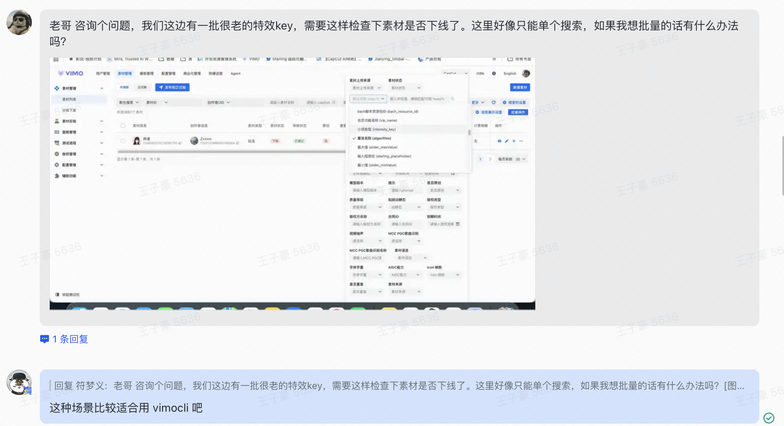<br/><br/><br/>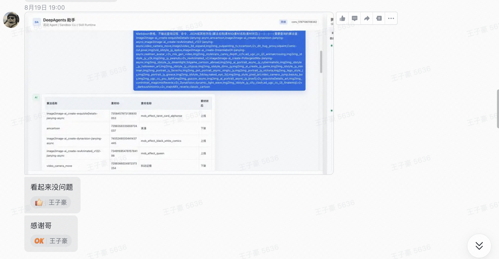 |
| 分类关系调整 | 运营 段佳倩 使用 Agent 批量调用分类关系操作，从贴纸各区域的 `love` 分类移除**一万多个素材关联**，保留素材实体。该次任务耗时由**人工 1 天缩短至 AI 15 分钟**。<br/><br/><br/>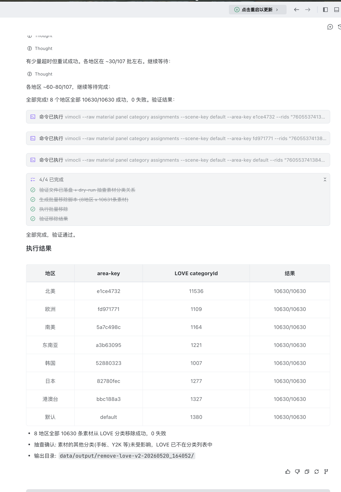 |
| 素材创建 | 特效团队调用素材上传、创建、编辑及面板／分类能力，将素材录入与面板维护接入特效生产。<br/><br/><br/>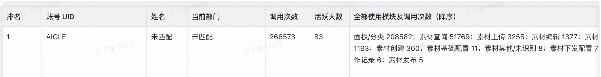 |
| 分级维护 | 针对近**200 条海外配置**补充主题色的需求，使用 CLI 批量维护，替代单条约 **15–20 秒**的页面操作。<br/><br/><br/>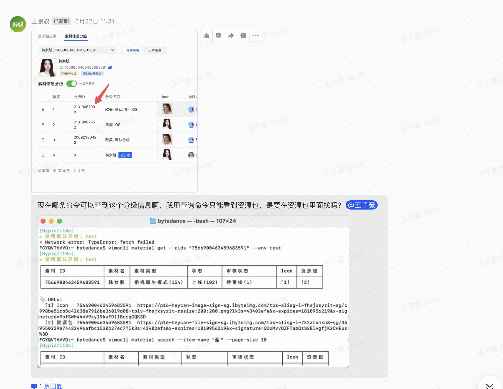 |


### 3.1.2.3 横向复用


| **接入方** | **介绍** | **相关资源** |
| --- | --- | --- |
| VIMO Agent & Capcut 运营 Agent | - VIMO 页面内提供自然语言操作入口，在沙箱内通过 vimocli 完成运营任务。<br/>- 复用 JWT 换取、沙箱凭证注入和生产网适配方案。 | 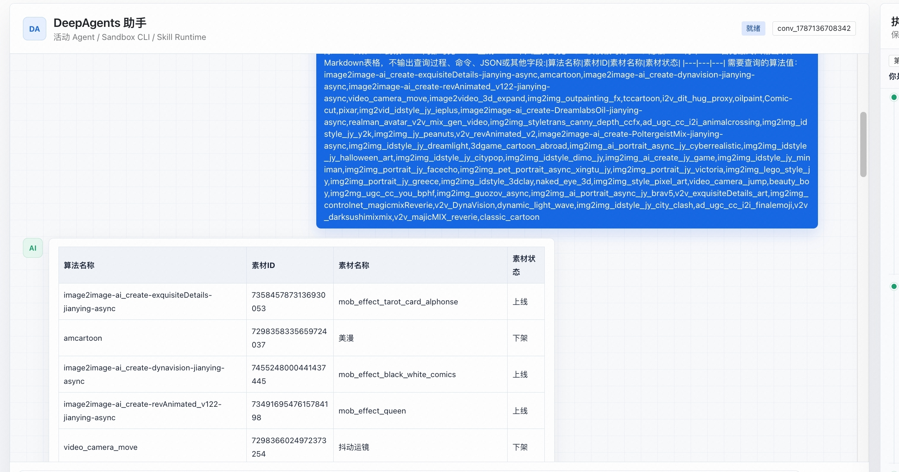<br/><br/><br/>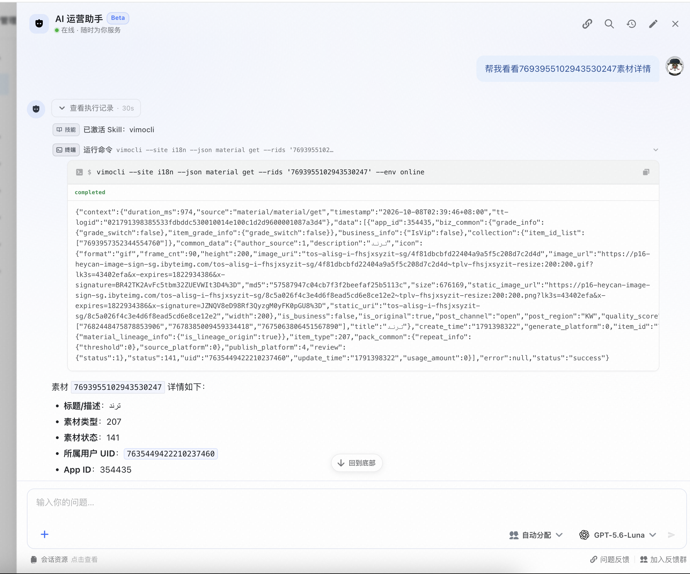<br/><br/><br/><br/><br/>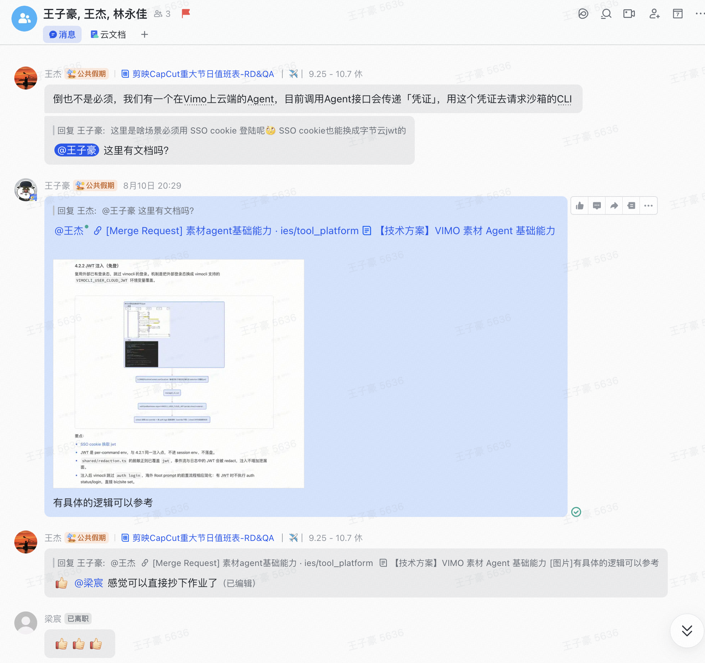 |
| Q&A Agent | 面向商业化 RD／QA 的测试辅助工具，接入 VIMO 策略预览 OpenAPI，由 MCP 工具配置和查询测试态。 | 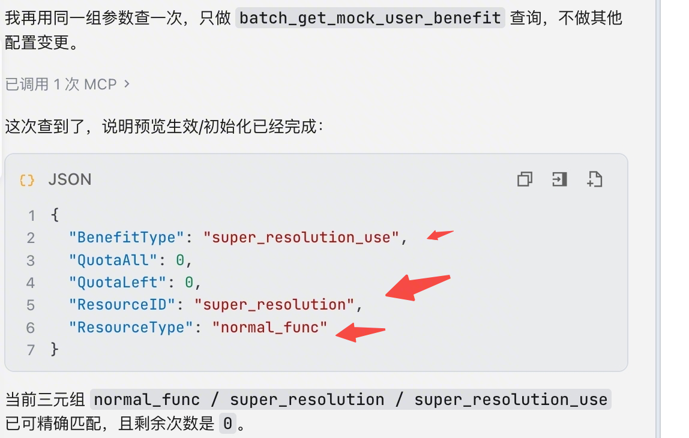 |
| 商业化后验证 | 面向研发交付后的 E2E 验证，接入vimocli 的资源位、活动、策略等信息读取与预览能力。 | 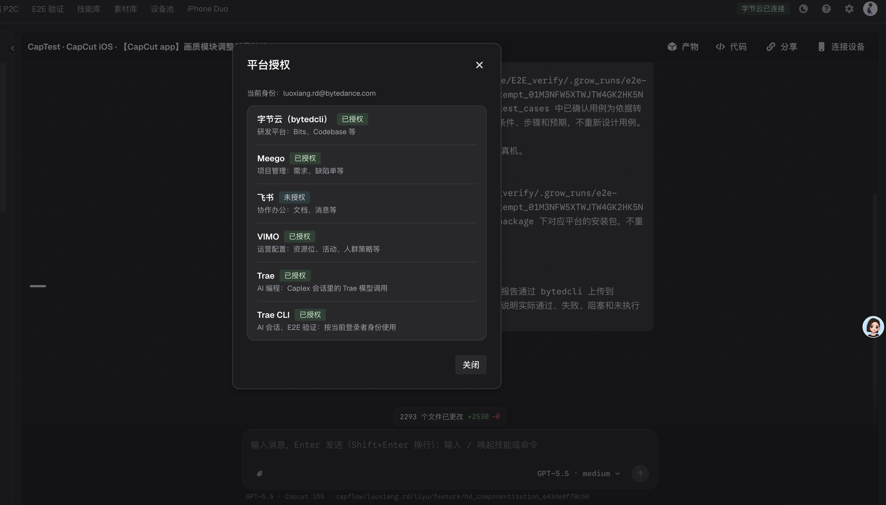 |
| GrowAI | 通过 vimocli 获取素材相关信息，辅助 Oncall 排查问题。 | [原文链接预览（回原位置查看）](https://bytedance.larkoffice.com/docx/LQ4Od0Od6ooDUZxdpX1cmo45nNf#A1zbdPxOSo4E5RxHx2zcUSyFngg) |


### 3.1.2.4 使用情况

Q3 开放能力使用情况: 


【原文高亮块】

累计调用 **622,670 次** · 用户 **313 人 **


【/原文高亮块】


【原文分栏开始】


【分栏】

**重复使用**

**109 个用户**调用不少于 100 次。


【分栏】

**持续使用**

**49 个用户**活跃不少于 10 天，其中 **11 人**活跃不少于 30 天。


【原文分栏结束】


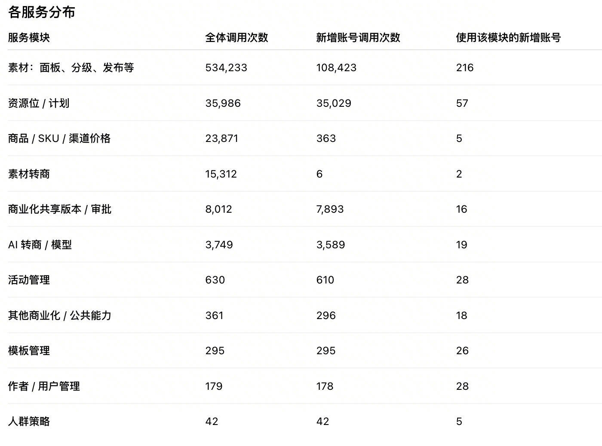

**推动实际使用**


【原文分栏开始】


【分栏】

**使用指南与宣贯**


- 编写[VIMO素材 AI能力 运营操作指南](https://bytedance.larkoffice.com/wiki/UBSLwhpbFi67eekQUkqcca9bnXe)，帮助5+运营下载使用。
- 组织[使用宣贯](https://bytedance.larkoffice.com/minutes/obcnu74eo85f31dd3a2gg1w6)，结合实际任务演示从哪里进入、怎样操作。


【分栏】

维护 VIMO CLI/Open API 使用群，解答权限和调用问题，收集使用反馈并跟进新增需求。


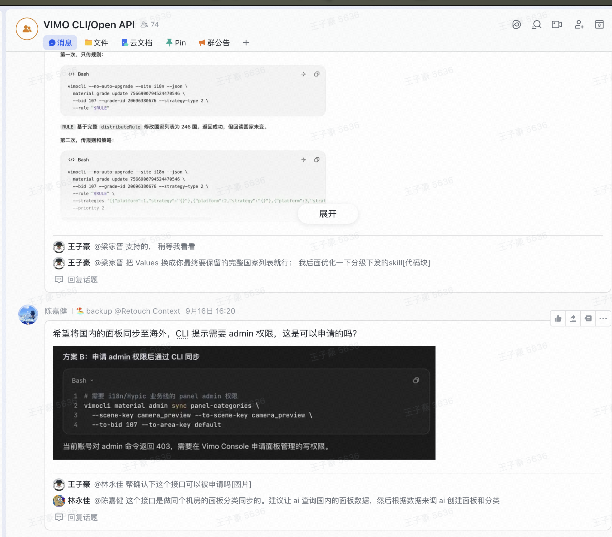


【原文分栏结束】


## 3.1.3 建设开放基础设施


### 3.1.3.1 设计开放架构

**建设目标：**用户、脚本和 Agent 都需要查询素材、调整面板分类、提交发布，只是组织任务的方式不同。我将这些入口共用的业务处理放在服务端，由 OpenAPI 提供调用能力，vimocli 将业务操作组织成命令，Skill 说明如何组合命令完成任务。

**系统架构**　


[原画板入口](https://bytedance.larkoffice.com/docx/LQ4Od0Od6ooDUZxdpX1cmo45nNf#NUaYdrCpboWrj2x8Mq7cDfFon4f)

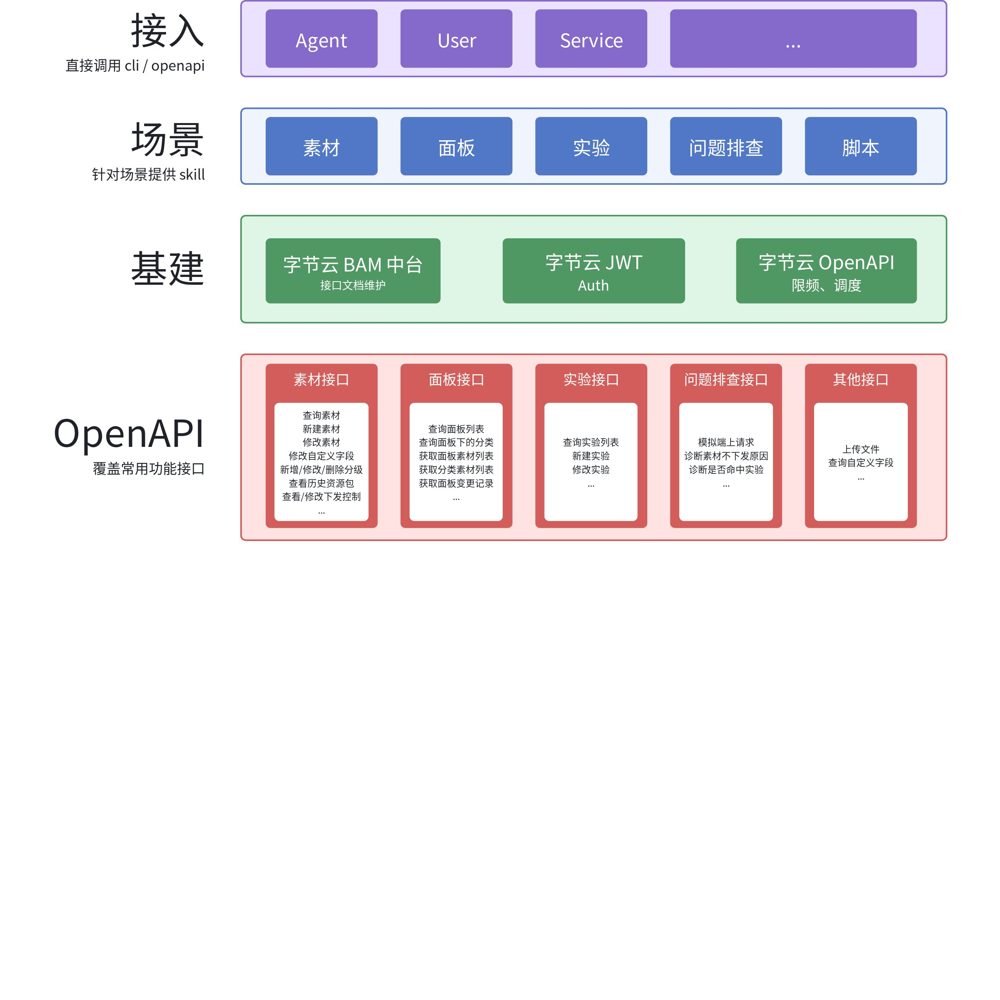


### 3.1.3.2 演进鉴权体系

**降低接入成本：**早期OpenApi使用 HMAC 签名，接入方需要维护密钥、编写签名逻辑，并联系研发开通权限。面向 CLI 和 Agent 开放后，使用者既有运营人员，也有运行自动化任务的服务账号；继续沿用这套方式，每增加一个使用入口，都要重复准备身份和授权。

接入字节云网关，复用其身份认证与路由能力，调用方不再自行处理 HMAC 签名。业务接口也有了统一的接入配置入口，国内、海外路由及鉴权配置可以集中管理。


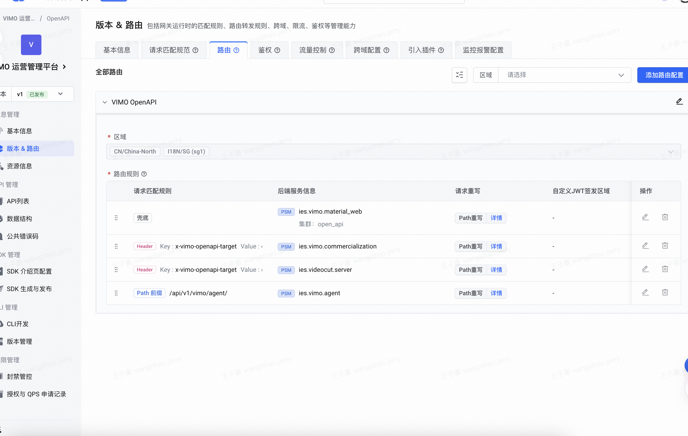

**缩短商业化接入路径：**商业化模块需要将活动、资源位等能力快速接入 CLI，用于验证运营 Agent 流程。与素材模块不同，这些直接调用与页面操作的**业务差异较小**，现有接口和 Kani 权限已经能够满足需求。如果每个接口都再走一遍 OpenAPI 接入，还要发布 BAM、配置网关并维护另一套授权，接入成本过大。


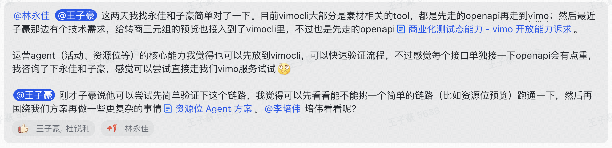

因此增加个人 JWT 直连：服务端识别 JWT 中的可信用户，再按原有 Kani 权限执行已有接口；客户端负责将这些接口组织成业务命令。

**鉴权链路**　


[原画板入口](https://bytedance.larkoffice.com/docx/LQ4Od0Od6ooDUZxdpX1cmo45nNf#YowqdFPdMoo4KgxKPW6cUqffnPc)

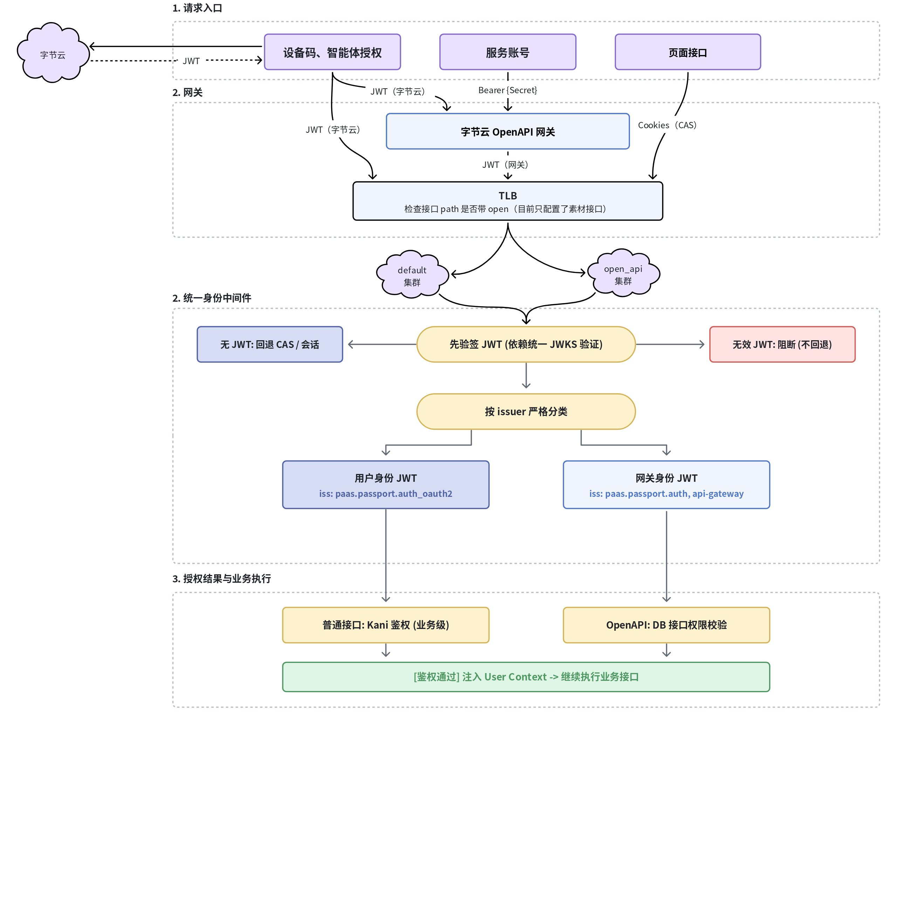


### 3.1.3.3 细化素材权限

**约束素材自动化的操作范围：**素材自动化会批量调整分类关联、更新素材配置，也会提交正式发布。接口能够处理多个面板和素材类型，而一次任务通常只需要操作其中一部分。直接授予接口调用权，无法表达这次任务究竟允许改到哪里。


【原文分栏开始】


【分栏】

**限定面板与素材范围：**以面板分类整理为例，程序只需调整指定面板下的分类关联。即使调用的是同一个分类操作接口，也不应因此获得其他面板的操作权。


【分栏】

**区分修改与正式发布：**分类调整、素材编辑与正式发布的影响不同。允许程序修改配置，不代表允许它将改动上线，修改权与发布权需要分别授予。


【原文分栏结束】

在接口权限之外增加资源授权：资源单位需要覆盖任务的主要操作范围，又不能随着每条素材的增减反复配置，因此选择业务线下的面板和素材类型，并分别设置新增、修改、发布权限。


| **授权粒度** | **对素材操作的约束** | **选择依据** |
| --- | --- | --- |
| 接口路径 | 控制能否调用分类调整、素材发布等接口。 | 保留为入口检查，同一接口中的不同面板与素材类型仍需单独限制。 |
| 面板／素材类型＋操作 | 面板相关操作限定目标面板；素材相关操作限定素材类型，并区分新增、修改与发布。 | 采用这一粒度，授权对应业务范围，无需为每条新素材重新配置。 |
| 单个素材 ID | 逐条指定允许操作的素材。 | 素材频繁新增和调整时，授权清单也要持续维护，当前未采用。 |


#### 3.1.3.3.1 封装素材鉴权服务

**抽取公共校验**　素材创建、编辑和发布都需要检查资源权限。为避免各接口重复编写权限查询和缺权提示，我将这部分封装为公共素材鉴权服务，由业务接口在实际操作前调用。

**统一缺权处理**　接口传入调用者、业务线、目标面板或素材类型，以及新增、修改、发布等操作。服务复用已有权限模型校验；缺权时返回统一错误信息，明确缺少的资源和操作权限，并附带对应的申请链接。

**接入业务接口**


| 接入操作 | 校验权限 | 接口接入方式 |
| --- | --- | --- |
| [创建素材](https://code.byted.org/ies/tool_platform/blob/ac503f03990d41a8b4648e3242a824983501fc5b/apps/material/api/lambda/openapi/v1/material/creatMaterial.ts) | 素材类型的新增权 | 按待创建的素材类型校验，通过后再创建。 |
| [编辑素材](https://code.byted.org/ies/tool_platform/blob/ac503f03990d41a8b4648e3242a824983501fc5b/apps/material/api/lambda/openapi/v1/material/updateMaterial.ts) | 素材类型的修改权 | 先按素材 ID 读取实体，再用实际类型校验，通过后保存。 |
| [批量发布素材](https://code.byted.org/ies/tool_platform/blob/ac503f03990d41a8b4648e3242a824983501fc5b/apps/material/api/lambda/openapi/v1/material/batchPublishMaterials.ts) | 本批次全部素材类型的发布权 | 回查素材并汇总类型，全部校验通过后才发起发布；任一类型缺权则停止。 |
| [新增、移除、重设分类关联](https://code.byted.org/ies/tool_platform/blob/ac503f03990d41a8b4648e3242a824983501fc5b/apps/material/api/lambda/openapi/v1/panel/setMaterialCategoryAssignments.ts) | 目标面板的修改权 | 修改素材与分类的关联前，检查所属面板权限。 |
| [按素材或分类发布面板](https://code.byted.org/ies/tool_platform/blob/ac503f03990d41a8b4648e3242a824983501fc5b/apps/material/api/lambda/openapi/v1/panel/publishByMaterialIds.ts) | 目标面板的发布权 | 按素材发布先校验待发布变更；按分类发布先校验分类归属，再检查面板发布权。 |

业务接口负责确定本次操作的资源，公共服务负责判断是否有权。素材编辑、素材发布与面板发布可以复用同一个校验入口，同时保留各自的操作规则。

[素材鉴权服务源码](https://code.byted.org/ies/tool_platform/blob/ac503f03990d41a8b4648e3242a824983501fc5b/apps/material/api/middleware/checkResourcePermission.ts)


[原画板入口](https://bytedance.larkoffice.com/docx/LQ4Od0Od6ooDUZxdpX1cmo45nNf#KEVldebnFo1B0zxLfjIc5vT9nrf)

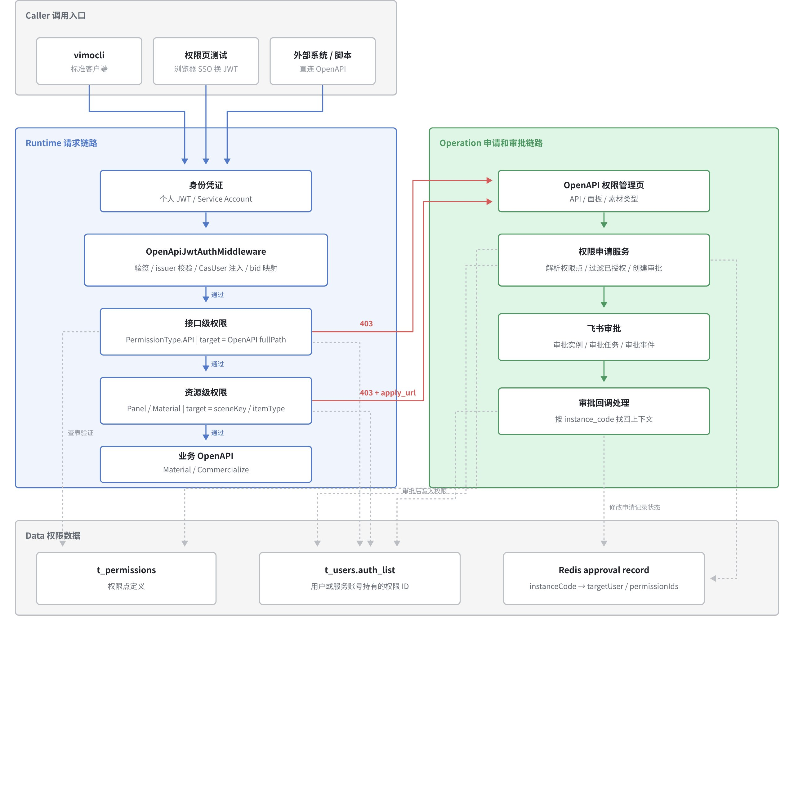


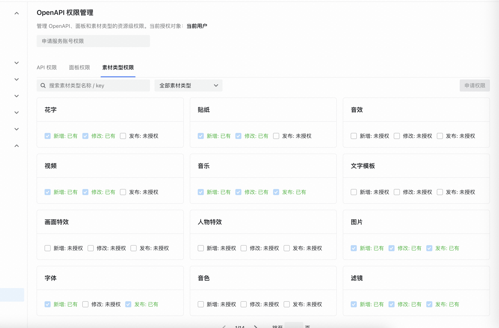


### 3.1.3.4 封装开放组件


#### 3.1.3.4.1 封装服务端接入组件

**统一身份接入：**素材、商业化等业务向 CLI 和 Agent 开放接口时，都需要验证调用者身份，并把验证结果交给原有权限系统。各业务的授权规则不同，JWT 验签、站点适配和用户信息转换却可以共用。我将这些逻辑封装为公共鉴权组件，业务方接入组件后，继续维护自己的接口和授权规则。

**衔接已有授权：**原登录检查依赖浏览器会话，直接携带 JWT 的程序请求会先被拦截。我将身份中间件放到登录检查之前：先验证 JWT，再转换为业务框架认可的用户上下文。已有页面接口继续执行 Kani；通过网关开放的接口执行 OpenAPI 权限，素材操作再检查资源范围。

**核心代码**　中间件在业务处理前完成身份验证、授权分流、业务线处理与调用上报。以下核心逻辑省略框架注入和组件初始化，错误响应由统一函数返回。


```typescript
async function handleRequest(request, response, next) {
  const config = appConfig.identityAuth;
  if (!config) return next();

  const authorizer = getGatewayAuthorizer(config);
  const openApi = authorizer?.resolveRequiredOpenApiTarget(request);
  const tokenHeader = (config.tokenHeader || "x-jwt-token").toLowerCase();
  const token = getHeaderValue(request.headers[tokenHeader]);

  if (!token) {
    return openApi ? reject(response, 401, "Missing JWT") : next();
  }

  const verifier = getJwtVerifier(config);
  let identity;
  try {
    identity = await verifier.verify(token);
  } catch (error) {
    logger.warn("JWT authentication failed", {
      path: request.path, error: error.message
    });
    const invalidIssuer = error instanceof IdentityJwtIssuerError;
    return reject(response, invalidIssuer ? 403 : 401,
      invalidIssuer ? "Invalid JWT Issuer" : "JWT Token Invalid");
  }

  const report = (bid, includeOpenApiEvent) => {
    const clientHeader = (config.clientHeader || "x-vimo-client").toLowerCase();
    void getTeaReporter(config).report({
      uid: identity.uid,
      path: request.path,
      bid,
      body: request.body,
      client: getHeaderValue(request.headers[clientHeader]),
      includeOpenApiEvent
    });
  };

  if (identity.identityType === "user") {
    const bid = getHeaderValue(request.headers["vimo-bid"]);
    if (openApi) {
      report(bid, false);
      return reject(response, 403, "Invalid JWT Issuer");
    }
    verifier.inject(identity, executionContainer);
    setIdentityAuthState(request, "direct_kani", identity.uid);
    report(bid, false);
    logger.info("User authenticated; Kani authorization pending");
    return next(); // 后续仍需执行 Kani
  }

  if (!authorizer) {
    logger.error("Gateway DB authorization config missing");
    return reject(response, 500, "Gateway DB authorization config missing");
  }

  let context;
  try {
    // 按方法、路径和业务线构造权限查询条件。
    context = authorizer.resolveContext(request);
  } catch (error) {
    if (error instanceof GatewayDbRequestError) {
      return reject(response, 400, error.message);
    }
    throw error;
  }

  // 先记录已验证身份的调用，缺权请求也可能进入统计。
  report(context.bid, true);
  if (!(await authorizer.hasPermission(identity.uid, context))) {
    logger.warn("No OpenAPI permission", { uid: identity.uid, ...context });
    return reject(response, 403, "No permission");
  }

  authorizer.writeBidToRequest(request, context);
  verifier.inject(identity, executionContainer);
  setIdentityAuthState(request, "gateway_db", identity.uid);
  logger.info("Gateway authenticated; OpenAPI authorization passed");
  return next(); // 后续沿用已完成的接口授权，业务仍校验资源权限
}
```

**调用上报**　统一记录调用身份、接口路径、业务线和子应用。


```typescript
// IdentityTeaReporter 内的事件组装与发送方法。
async function report(params) {
  const base = {
    uid: params.uid,
    url_path: params.path,
    sub_app: this.options.getPsm(),
    timestamp: Date.now().toString(),
    bid: params.bid
  };
  const events = [];

  if (params.includeOpenApiEvent) {
    events.push({
      eventName: "call_open_api",
      params: {
        ...base,
        req_body: JSON.stringify(params.body),
        auth_type: "jwt"
      }
    });
  }

  if (["vimocli", "bytedcli"].includes(params.client)) {
    events.push({
      eventName: "call_open_api_vimocli",
      params: base
    });
  }

  await this.transport.report(events, params.uid);
}
```


【原文高亮块】

**接入收益: **公共鉴权包已接入素材、商业化、平台主应用、模板和用户管理 **5 个模块。**


【/原文高亮块】


#### 3.1.3.4.2 封装 JWT 凭证工具

**背景**　在建设接口自测页时，我发现字节云支持用浏览器已有登录态换取个人 JWT。利用这一能力，自测页可以直接以当前用户身份发起请求，省去手动获取、复制凭证的步骤。

**抽取公共工具**　凭证获取只依赖用户登录态和目标站点，与具体测试接口无关。为了方便其他业务接入，并统一处理站点选择、凭证缓存与过期刷新，将它抽取为 `@vimo/utils/browser`。业务方调用公共工具取得凭证，再组织自己的业务请求，无需从自测页复制一套实现。

**对接字节云签发**　字节云负责登录校验和 JWT 签发，公共工具在浏览器侧携带登录态请求凭证，不自行生成 Token。


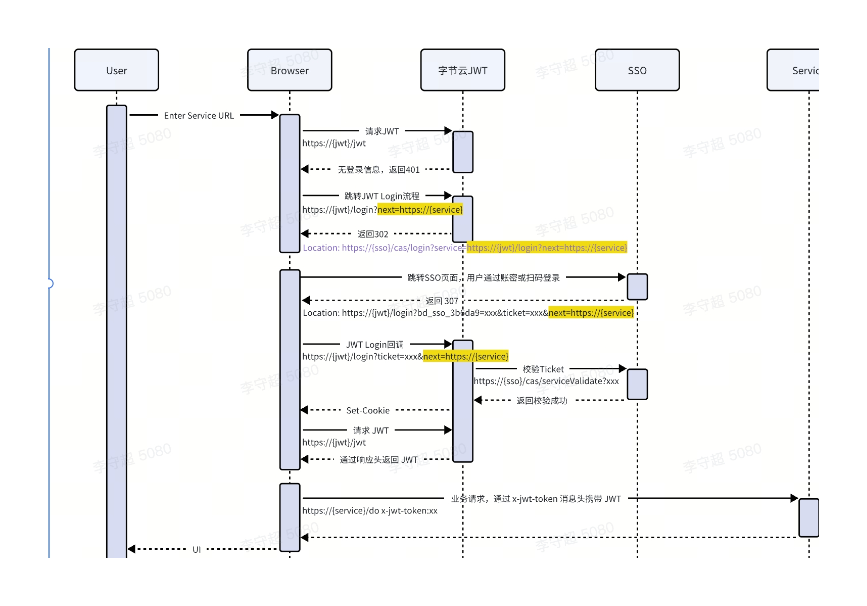

**管理凭证有效期**　公共工具按国内、海外站点分别缓存 JWT，在使用时检查有效期。缓存缺失或距到期不足 60 秒时，重新向字节云请求凭证，业务入口不必自己维护刷新逻辑。


- 业务接口返回 401 时，跳过旧缓存，重新请求 JWT，并用新凭证重试一次。
- 若字节云的 JWT 获取接口返回 401，则说明字节云登录态已失效。工具将这一状态交给业务入口，由页面提供登录入口。


```typescript
async function getJwt(site, forceRefresh = false) {
  if (!forceRefresh && cacheValid(site, 60_000)) {
    return cache[site];
  }
  const response = await fetch(jwtEndpoint(site), {
    credentials: "include"
  });
  if (response.status === 401) throw loginRequired(site);
  if (!response.ok) throw jwtFetchFailed(response);
  return cacheJwt(site, response.headers.get("x-jwt-token"));
}

async function callWithJwt(site, request) {
  const result = await request(await getJwt(site));
  if (result.status !== 401) return result;
  return request(await getJwt(site, true));
}
```


【原文高亮块】

已用于 **5 类业务场景**，共用凭证获取、缓存与刷新。


【/原文高亮块】


| 接入场景 | 实际使用 |
| --- | --- |
| 接口自测 | 使用公共请求封装，以当前用户身份检查接口参数与权限。 |
| 素材同步工具 | 沿用自测页的调用封装，在页面中调用素材同步 OpenAPI。 |
| 素材搬运建单 | 取得申请人 JWT 向 BPM 创建工单，保留申请人的任务归属与取消权限。 |
| VIMO Agent & Capcut 运营 Agent | 页面取得 JWT 后随任务请求传递，为沙箱中的 vimocli 提供用户身份。 |


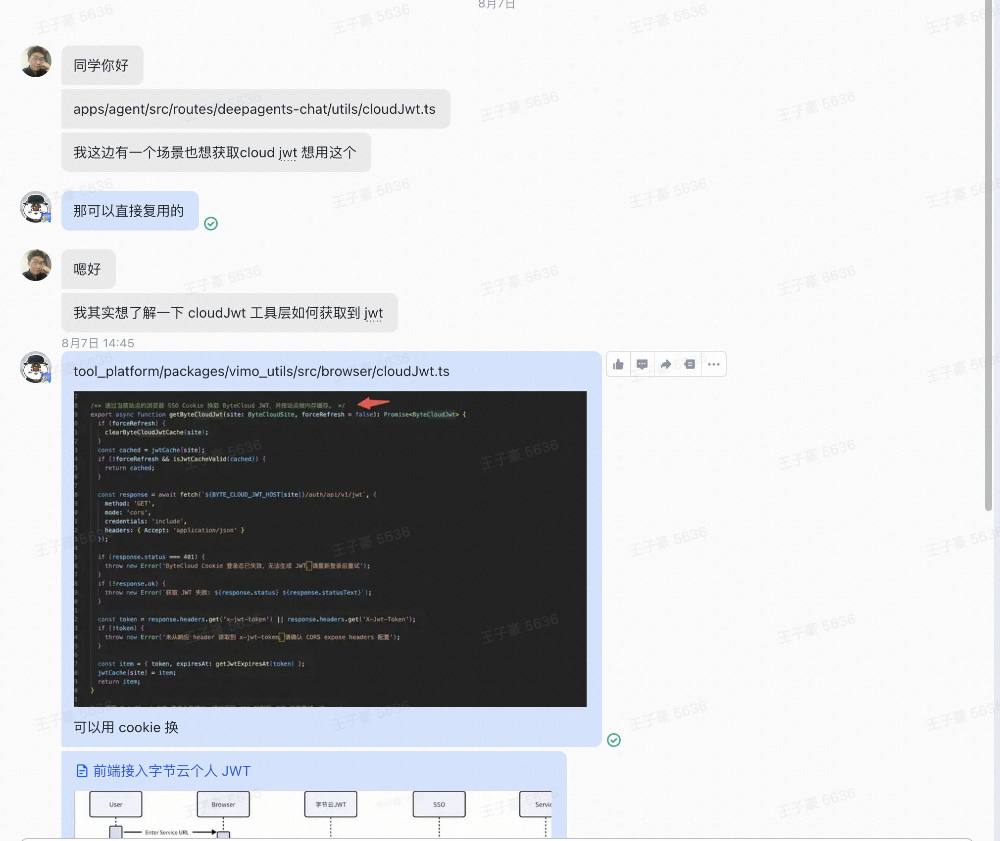

**封装云端免登录方案**　页面取得 JWT 后，对于Agent场景云端沙箱仍无法直接使用浏览器登录态。如果沙箱中的 vimocli 再要求登录，用户就要为同一次任务重复授权。我将页面换取 JWT、后端传递身份、沙箱注入凭证和生产网访问配置整理成配套方案，让 CLI 使用当前用户身份执行。

**按次注入执行身份**　沙箱会被多轮任务复用，凭证与业务线若固定在初始化配置中，后续执行就可能沿用旧身份或旧业务线。因此，每次工具调用都从当前请求注入 JWT 与业务线，CLI 不将注入凭证写入本地登录配置；命令退出后，注入的运行环境随执行进程结束，JWT 本身仍按签发有效期过期。


[原画板入口](https://bytedance.larkoffice.com/docx/LQ4Od0Od6ooDUZxdpX1cmo45nNf#Rswqd772joxjiQxoDhQcmjoanEb)

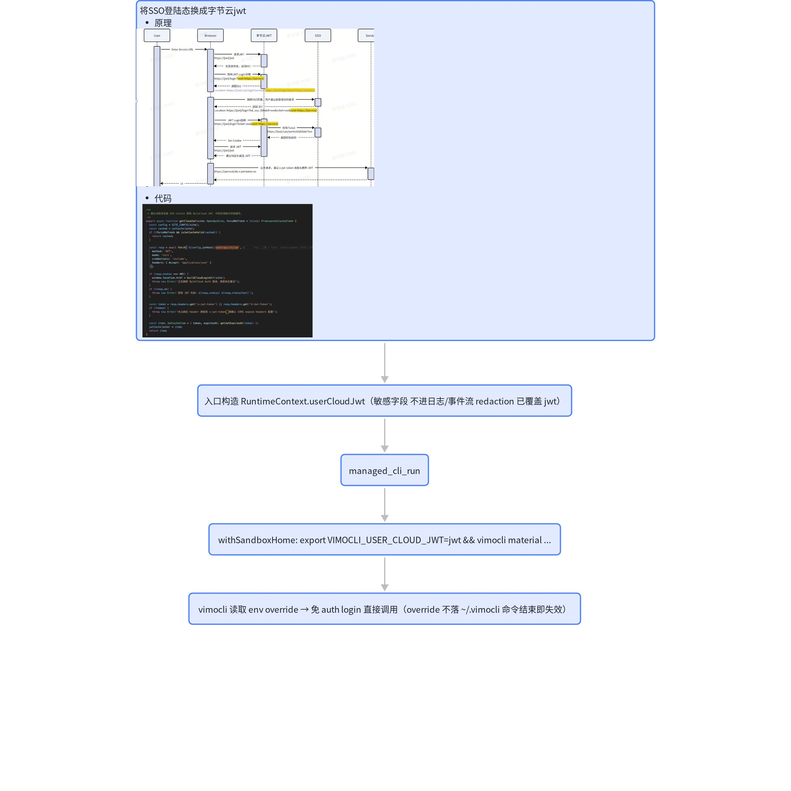


【原文高亮块】

**方案复用**　VIMO Agent、Capcut 运营 Agent **2 个云端 Agent**已采用这套接入方式。页面有有效字节云登录态时，用户无需在沙箱里再登录 vimocli；两端继续使用各自的对话交互与任务逻辑。


【/原文高亮块】


## 3.1.4 构建 vimocli 客户端


### 3.1.4.1 设计整体架构

**客户端定位：**vimocli 为人工操作、自动化脚本和 Agent 提供统一的业务命令入口。业务功能按模块组织，配置、身份、请求执行和结果输出由公共能力承接。

**设计参考：**参考 [bytedcli 与 lark-cli 的设计](https://bytedance.larkoffice.com/wiki/QcnZwk7zZisJOXksUYmcAl6anWh)，将常用业务命令与接口生成命令分开，兼顾操作体验与接口覆盖；Skill 采用统一入口、内部按领域组织的方式，让 Agent 根据任务加载说明。两项设计分别解决命令如何提供、Agent 如何使用的问题。

**整体架构**


[原画板入口](https://bytedance.larkoffice.com/docx/LQ4Od0Od6ooDUZxdpX1cmo45nNf#FBMbdGymuokIijxuEL6czmpVnge)

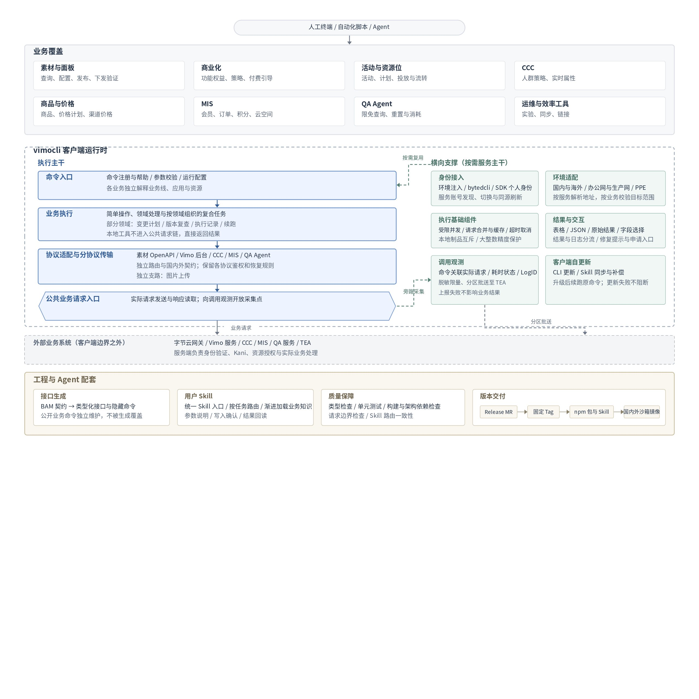

**能力建设**客户端按以下职责组织，各业务模块复用公共执行能力，Skill、测试与版本交付提供配套支持。


- **工程框架层**划分业务命令、系统适配与公共执行职责，使用 BAM／IDL 自动生成接口调用代码和隐藏命令。公开命令独立维护参数语义、输入校验与结果呈现，接口同步不会覆盖手写的业务设计。
- **业务功能层**覆盖素材查询、创建与编辑，面板及分类配置、实验和运维操作；承接商业化、活动、资源位、人群策略、实时属性、商品及关联查询。不同系统的参数包装与响应转换由对应模块处理，对外提供按业务对象组织的命令。
- **公共运行层**提供业务线与站点解析、网络配置、个人及服务账号接入、请求执行和统一输出。表格用于人工阅读，JSON 与退出状态供脚本和 Agent 处理，日志及更新提示独立输出，避免干扰结果解析。
- **Agent 协作层**配套统一 Skill、领域指南和公共参考，提供任务分流、命令选择、参数约束及写操作确认与回读要求。Skill 负责说明任务方法，实际鉴权和接口请求仍由 CLI 执行。
- **质量观测层**建设类型检查、单元测试、构建校验及公共请求入口检查，并关联命令、请求与响应采集调用数据。新增业务沿用已有检查与采集入口，无需分别建设一套配套能力。
- **版本交付层**配套 CLI 包与用户 Skill 发布，在用户侧提供版本检查、自动升级与 Skill 同步。发布端交付新能力，客户端负责将更新带到本地执行环境。


### 3.1.4.2 优化使用体验

业务命令交付后，使用中还会遇到说明分散、环境不同、账号选择和版本滞后等问题。对应的配套能力集中在客户端维护，避免每个业务重复处理。


| 能力 | 背景 | 方案 | 相关资源 |
| --- | --- | --- | --- |
| Skill 组织 | 原先按业务拆成多个独立 Skill，跨领域任务需要组合读取，安装和更新也要分别处理。直接合成一篇长文，又会让简单任务读入大量无关说明。 | - 将独立 Skill 收进一个 vimocli Skill，统一安装与更新。<br/>- 总入口判断任务所属领域，再加载素材、面板等操作指南；认证、调用方式与排障说明集中维护。 | 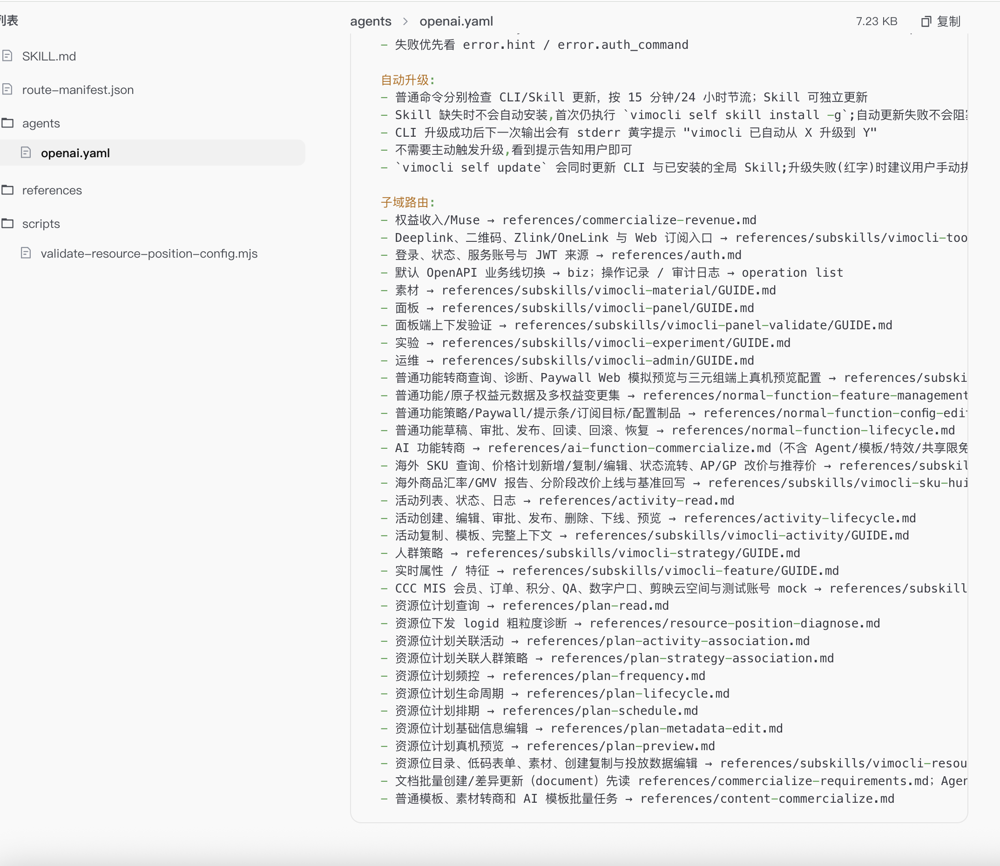 |
| 多环境适配 | 身份方面，Aime、本地 Agent 已有可用凭证，重新要求用户登录会增加操作。<br/><br/>网络方面，云端沙箱与本地办公网的访问条件不同，需要匹配各自可达的服务地址。 | - 支持环境注入、bytedcli 与 SDK 等凭证来源，让 CLI 使用当前环境已有的身份。<br/>- 按服务、站点和网络配置选择请求入口，业务命令无需随执行环境改写。 | 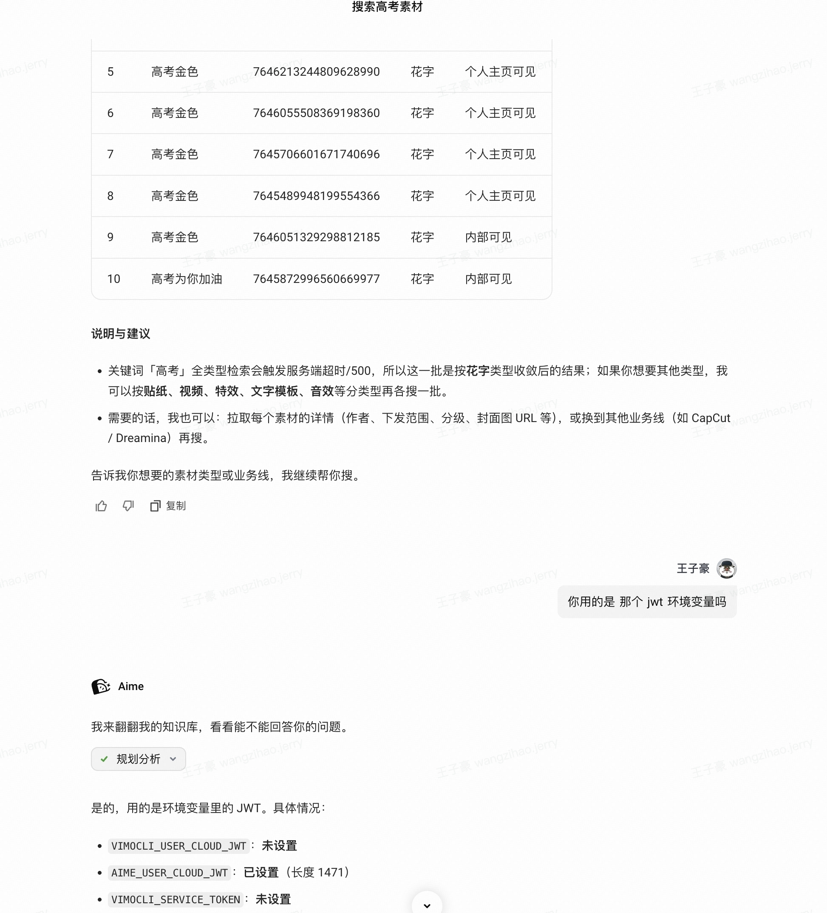<br/><br/><br/>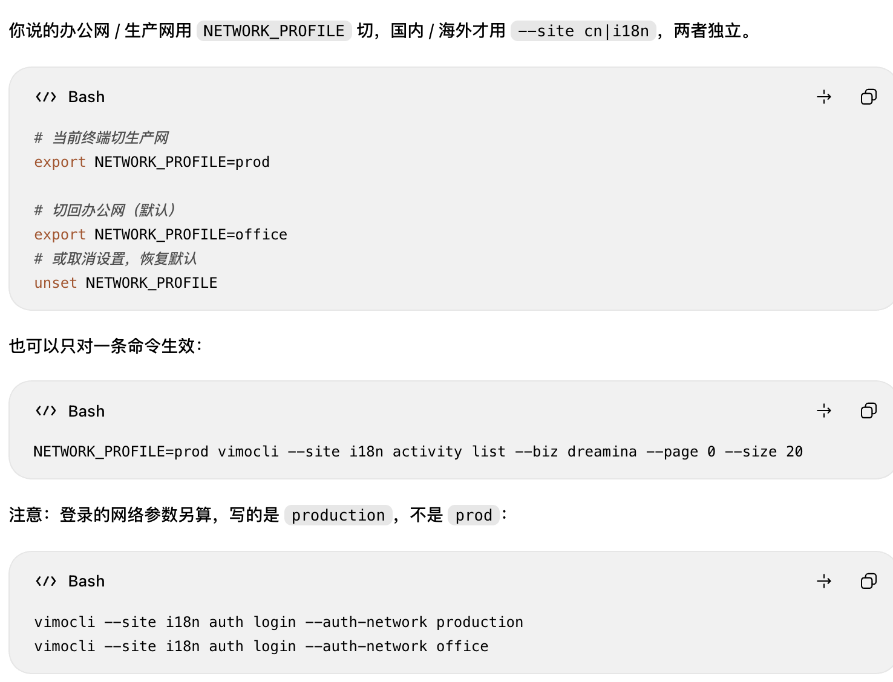 |
| 服务账号管理 | 批量脚本、定时任务和自动化验证需要在云端持续运行，依赖个人临时登录容易打断执行。商业化后验证是其中一类接入需求。 | - 提供服务账号发现、激活、切换及分站点管理，明确当前使用的调用主体。<br/>- 支持服务账号的 OpenAPI 使用选定主体；个人直连接口继续使用个人身份。 |  |
| 自更新 | 依赖用户主动升级时，新功能虽然已经发布，本地 CLI 和 Agent 使用的说明仍可能停留在旧版。用户没有感知到更新，也就无法及时用上新能力。 | - 普通命令执行时检查版本，发现新版后自动安装，减少用户手动查看版本和升级的步骤。<br/>- 新包安装时使用新版逻辑同步已安装的 Skill，并检查实际更新结果。未完成的同步由后续启动补做；Skill 也可独立更新，不必等待 CLI 发布新版。<br/>- 支持的平台升级完成后，由新进程重新执行原命令；升级失败则提示用户并继续原有业务。临时运行和源码开发不修改全局安装。 | 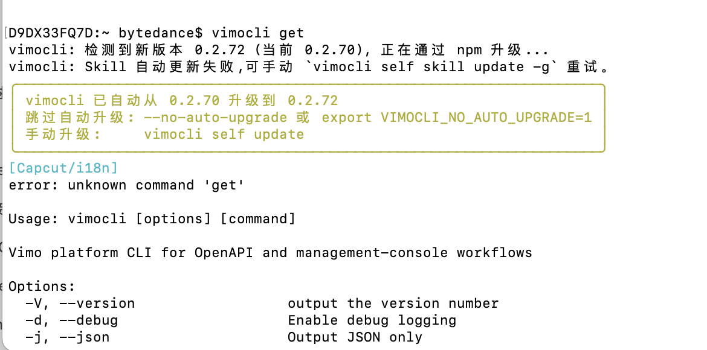<br/><br/><br/>[原画板入口](https://bytedance.larkoffice.com/docx/LQ4Od0Od6ooDUZxdpX1cmo45nNf#Oj3zdYuK6oc2PUxkyRYcs7BIn5g)<br/><br/>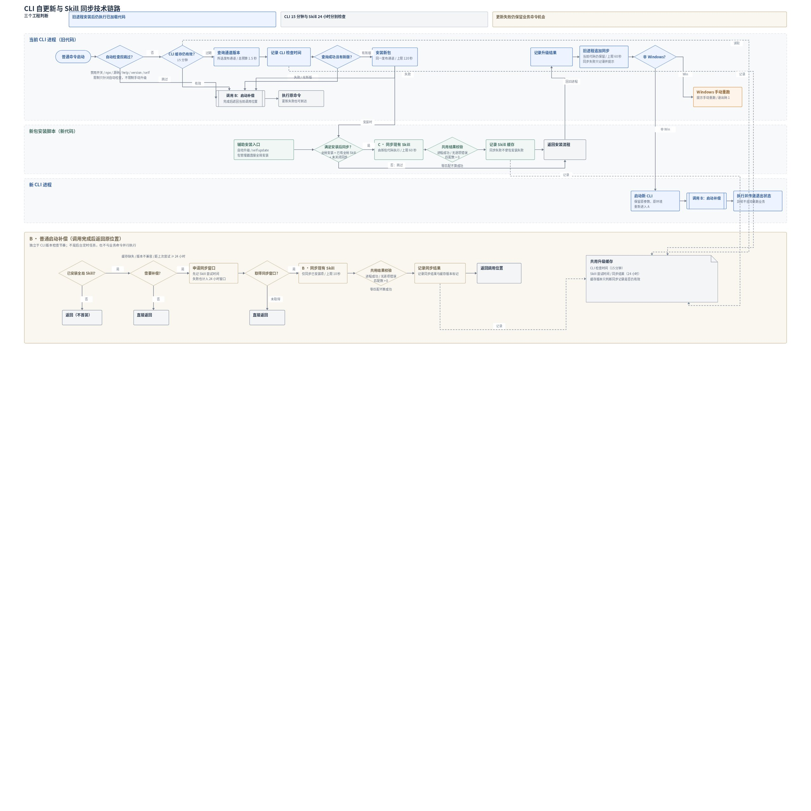 |


### 3.1.4.3 埋点统计

最初是服务端埋点记录经过 VIMO 中间件的开放调用，能够统计接口使用情况。v但imocli 对 CCC、MIS、QA 等系统的请求不经过这层中间件，因此这部分使用无法出现在原有统计中；仅有接口记录，也难以判断用户执行的是哪条客户端命令。

**覆盖扩展：**为补齐客户端视角，我将采集接入 vimocli 公共请求入口，记录命令来源及实际调用信息。原服务端事件继续保留，两端分别统计，避免将开放接口使用与 vimocli 使用混为一谈。


| 观察内容 | 服务端采集 | 客户端采集 |
| --- | --- | --- |
| 调用范围 | 经过 VIMO 埋点中间件的开放请求。 | 经过 vimocli 公共请求入口的跨系统业务请求。 |
| 操作信息 | 接口、调用身份、业务线。 | 补充命令模块、操作、实际地址及业务入参、返回。 |
| 结果信息 | 服务端开放调用记录。 | 关联对应请求的响应、错误与服务端 LogID。 |

**采集设计：**逐条命令添加埋点，需要持续跟进新增功能；只在请求发送处采集，又缺少命令来源。因此，我将命令信息传递到公共请求入口，在统一位置关联请求与结果。


- 命令开始时记录模块与操作，发送请求时补充实际目标、业务线及调用身份，使接口调用能够归属到具体业务命令。
- 业务读取响应或发生异常时，完成对应请求的采集。一次命令发出多次业务请求，就生成多条记录，不要求每个接口单独配置埋点。
- 将公共请求入口检查纳入 MR 与发布校验，新增业务沿用同一采集方式；认证、文件传输和外部 CLI 内部请求按范围排除。

**采集架构**


[原画板入口](https://bytedance.larkoffice.com/docx/LQ4Od0Od6ooDUZxdpX1cmo45nNf#HHZPdnviYoQuyDx1Nntc59u3nAd)

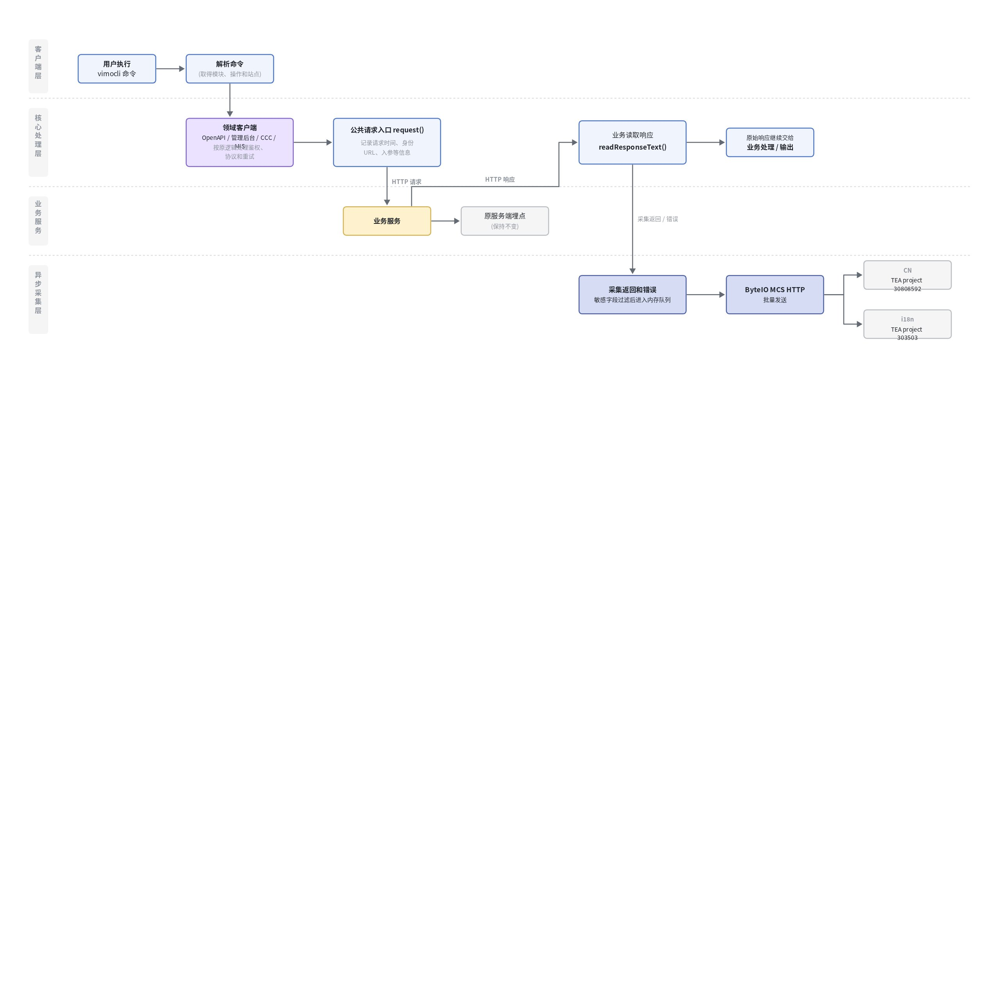


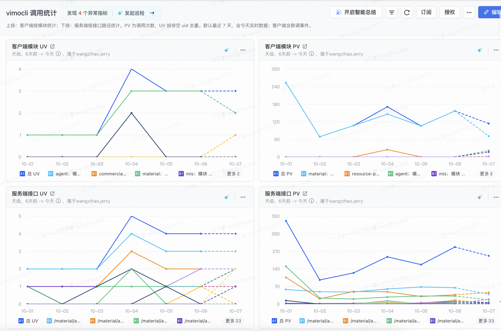


## 3.1.5 完善交付协作机制


### 3.1.5.1 沉淀研发文档与 Skill

**背景：**新增开放能力时，服务端、网关和 CLI 往往需要配套修改。代码位置、后台配置和验证方式分散在不同仓库与平台，后续接入需要反复查找、重新确认。

**研发文档：**分别维护设计文档和接入指南：前者解释系统关系与方案选择，后者提供代码位置、平台配置和真实接入示例。


| 沉淀内容 | 代表材料 | 具体用途 |
| --- | --- | --- |
| 整体设计 | [OpenAPI 与 vimocli 整体设计](https://bytedance.larkoffice.com/wiki/QcnZwk7zZisJOXksUYmcAl6anWh) | 说明系统关系、权限与自测、客户端设计，以及素材发布和商业化预览的调用链路。 |
| 跨服务接入 | [跨服务 OpenAPI 接入记录](https://bytedance.larkoffice.com/wiki/US3uwQ8XtiVtlWkgYItcg5qpnfe) | 关联目标服务、BAM、网关、权限与 CLI 的改动位置，区分人工平台配置和 AI 可执行的代码工作。 |
| 快速接入 | [VIMO CLI 快速接入方案以及步骤](https://bytedance.larkoffice.com/wiki/GbcNwsuAzivvMakKOcxcuBBDnKc) | 说明个人 JWT 如何接入已有接口与 Kani，并补齐命令、用户 Skill 和验证步骤。 |

**开发 Skill：**接入指南之外，研发 Agent 还需要知道当前任务应执行哪一步、检查哪些结果。我用 `vimo-api-to-cli` 作为总入口，按任务阶段加载 **6 个开发 Skill**，分别约定工作范围与交付检查。


| 阶段 | 开发 Skill | 约定交付 |
| --- | --- | --- |
| 需求沟通 | `vimo-openapi-requirements` | 确认业务对象、参数语义、数据范围与验收条件。 |
| 创建环境 | `vimo-create-env` | 准备开发分支、PPE 与开发任务，记录联调入口。 |
| 开发接口 | `vimo-openapi-bam` | 实现并验证 OpenAPI，发布 BAM 定义，核对网关配置。 |
| 更新客户端 | `vimo-vimocli-update` | 生成 API 调用，补充业务命令、测试及用户 Skill。 |
| 测试发布 | `vimo-vimocli-test-publish` | 验证测试包与目标环境调用，发布 CLI 包及用户 Skill。 |
| 发布归档 | `vimo-release-archive` | 汇总两端 MR、BAM、安装包和测试结果，保留未完成事项。 |

涉及新服务接入时，配套使用 `vimo-openapi-onboarding` 核对运行时服务、BAM 服务、网关路径和权限配置。这些信息随目标服务变化，Skill 要求重新确认实际值，避免把历史案例的服务名和路径直接用于新业务。


### 3.1.5.2 建设发布流水线

**发布背景：**一次 vimocli 发版需要同时更新 npm 包、用户 Skill 和国内外沙箱镜像。各项操作分散在不同平台，发布人需要反复切换、等待并检查结果。手工改版本或漏发某项产物，还可能造成新SKILL对应旧命令、镜像仍安装旧版本。

**自动化范围：**我将三类发布操作接入 CI，统一执行质量检查、产物分发和结果核对。


| 发布对象 | 原来需要手动处理 | 流水线负责完成 |
| --- | --- | --- |
| npm 包 | 改版本、检查、构建、发包，确认发布版本。 | - 自动计算版本。<br/>- 执行类型检查、代码检查、测试与构建。<br/>- 发布后回读版本和包内容摘要。 |
| 用户 Skill | 找出变更目录，逐项上传并检查平台结果。 | - 包发布后，按前后 Tag 差异增量发布。<br/>- 逐项回读 Skill 平台上的发布结果。 |
| 国内外沙箱镜像 | 分别打开模板，修改工具版本、提交构建并等待结果。 | - 保留模板配置，固定安装本次 CLI 版本。<br/>- 分别构建国内、海外镜像，核对版本与安装结果。 |

**发布流程：**功能代码合入后，流水线自动准备 Release MR，并通过飞书提醒发布人检查。人工确认并合入后，再创建 Tag，依次发布安装包、增量 Skill、国内和海外镜像。


[原画板入口](https://bytedance.larkoffice.com/docx/LQ4Od0Od6ooDUZxdpX1cmo45nNf#CdRqd9840oDqcsx3cG2cZiFKn4f)

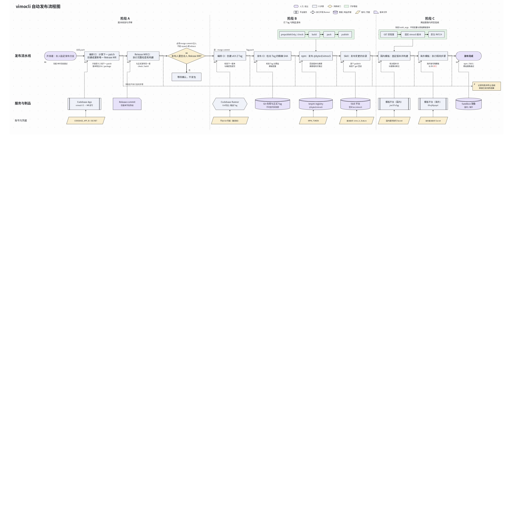


### 3.1.5.3 管理并行任务

**并行背景：**vimocli 发展期，业务接入、鉴权、埋点和发布改造同时推进。不同任务的进度和产物分散在多个会话中，需要反复查找；将它们放进同一个长会话，又容易把上一项需求的假设带入下一项工作。

基于 Mira 搭建工作台，将进度与任务入口集中展示，每项任务仍保留独立会话。


【原文分栏开始】


【分栏】

**集中查看进度**


- 查看哪些任务正在进行、哪些需要确认，并找到对应产物。
- 处理某项任务时，从总览直接进入对应会话。


【分栏】

**独立保留会话**


- 每项需求保留自己的讨论、分支和环境信息。
- 继续任务时回到原会话，不在一个长会话里反复切换不同需求。


【原文分栏结束】


[原录屏：录屏2026-05-12 11.43.34.mov](https://bytedance.larkoffice.com/docx/LQ4Od0Od6ooDUZxdpX1cmo45nNf#AwmRdLcuXoxqF3x5FwscxTsrnBd)


## 3.1.6 规划


【原文分栏开始】


【分栏】

**优化用户 Skill**

结合使用记录和运营反馈，完善高频任务的操作示例、参数说明和结果检查方法。用典型任务和失败案例验证修改效果，减少 Agent 选错命令、遗漏步骤和反复询问的情况。


【分栏】

**沉淀运营工作流**

与运营梳理日常重复操作，优先探索素材批量维护、分类整理、下发检查等高频流程。将已有接口组合成可复用的工作流，明确输入、操作顺序和结果核对方式，在真实任务中试用并调整。


【分栏】

**扩展素材接口**

以素材业务为主，按实际需求补充查询、配置、分类维护等接口，优先解决现有能力无法完成、仍需人工处理的操作。


【原文分栏结束】

