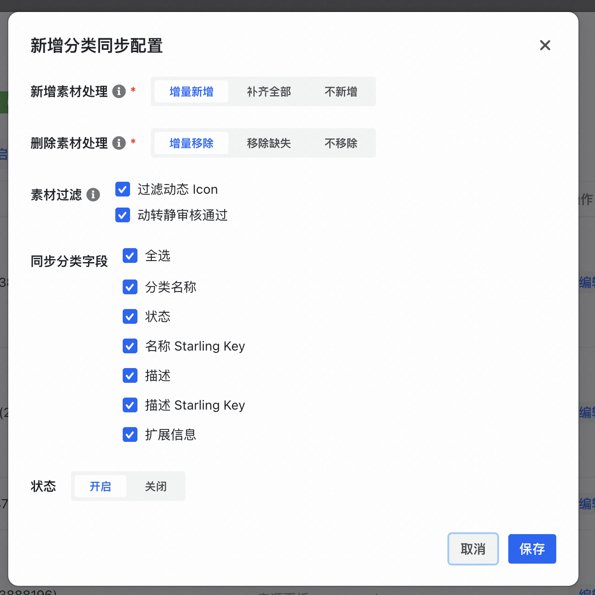
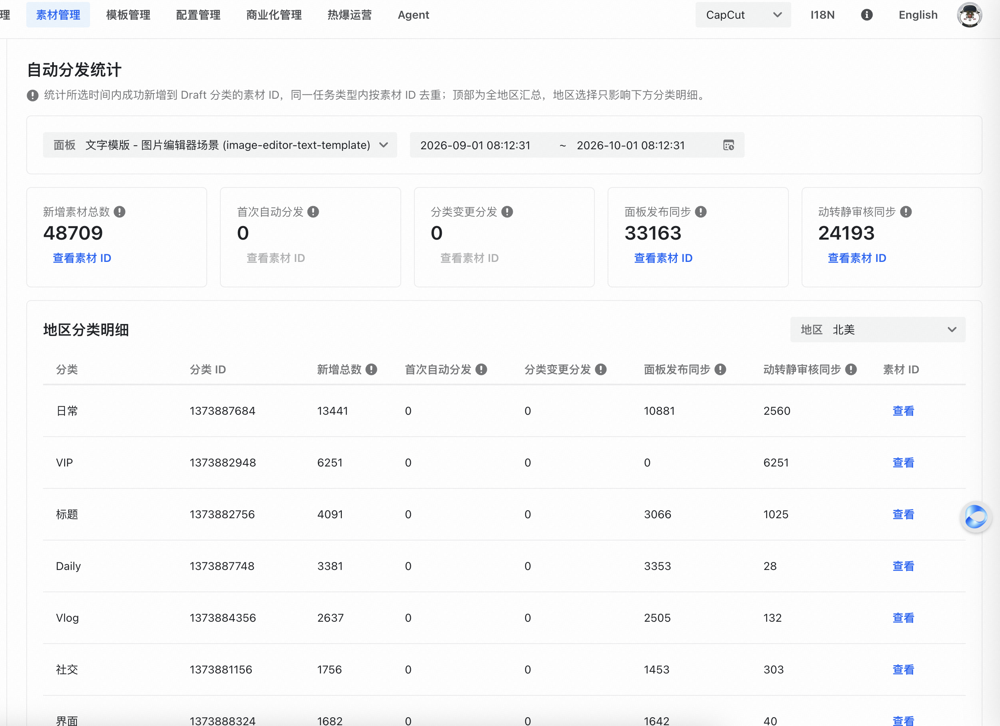
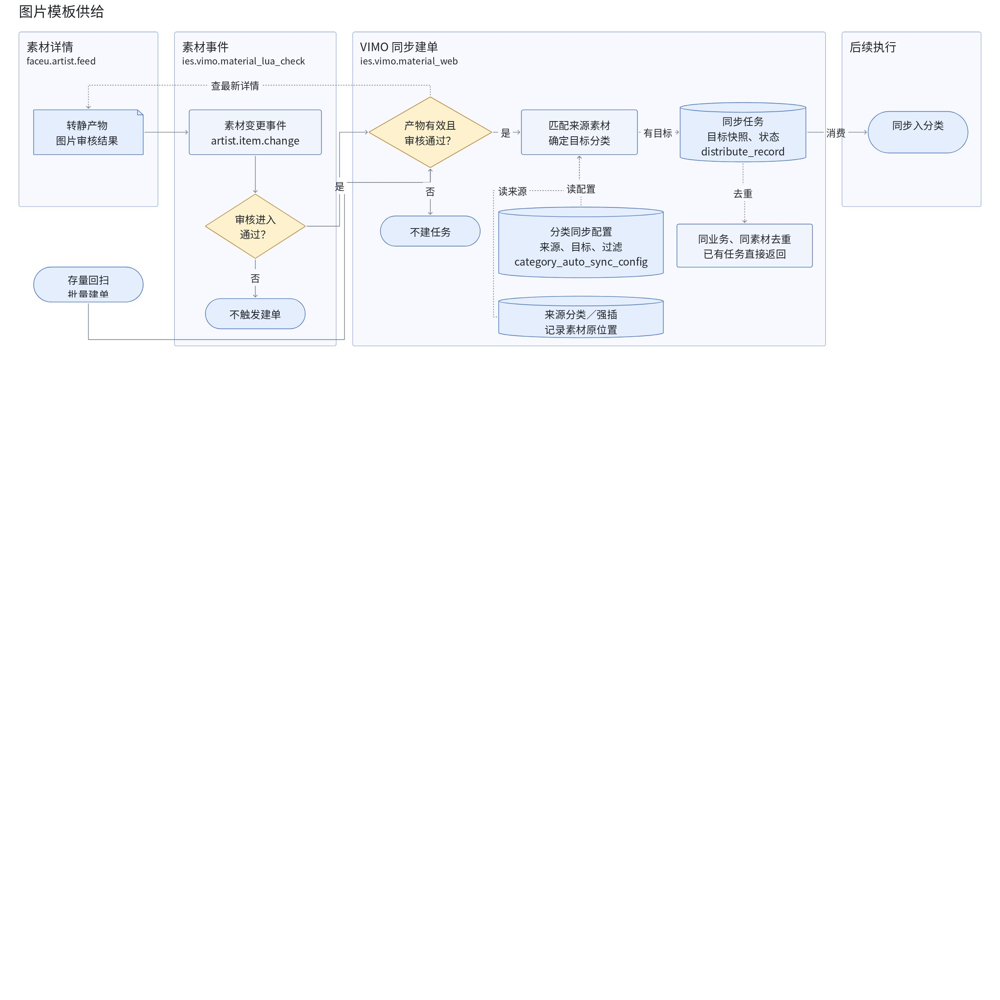
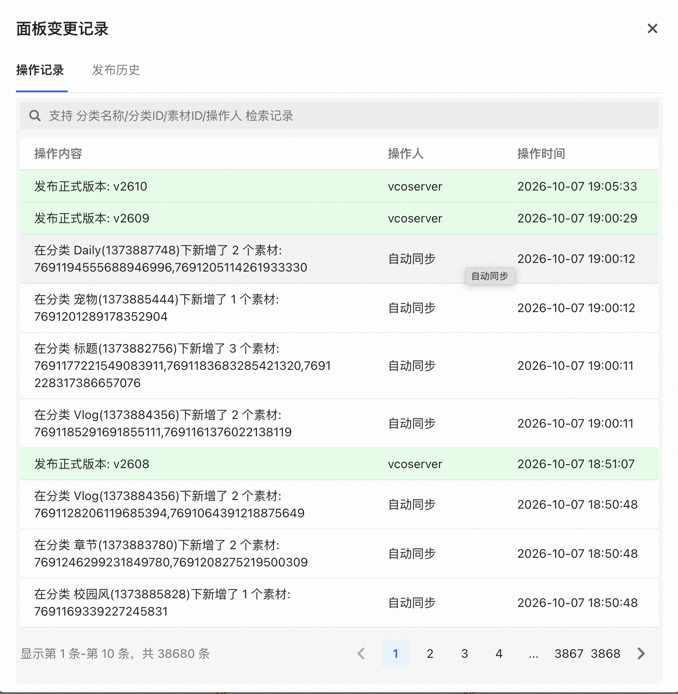
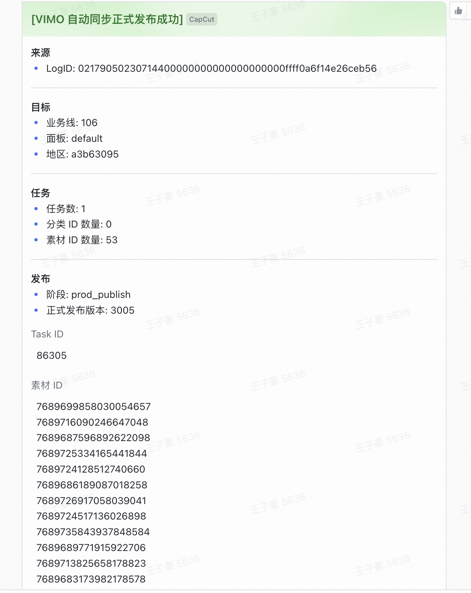
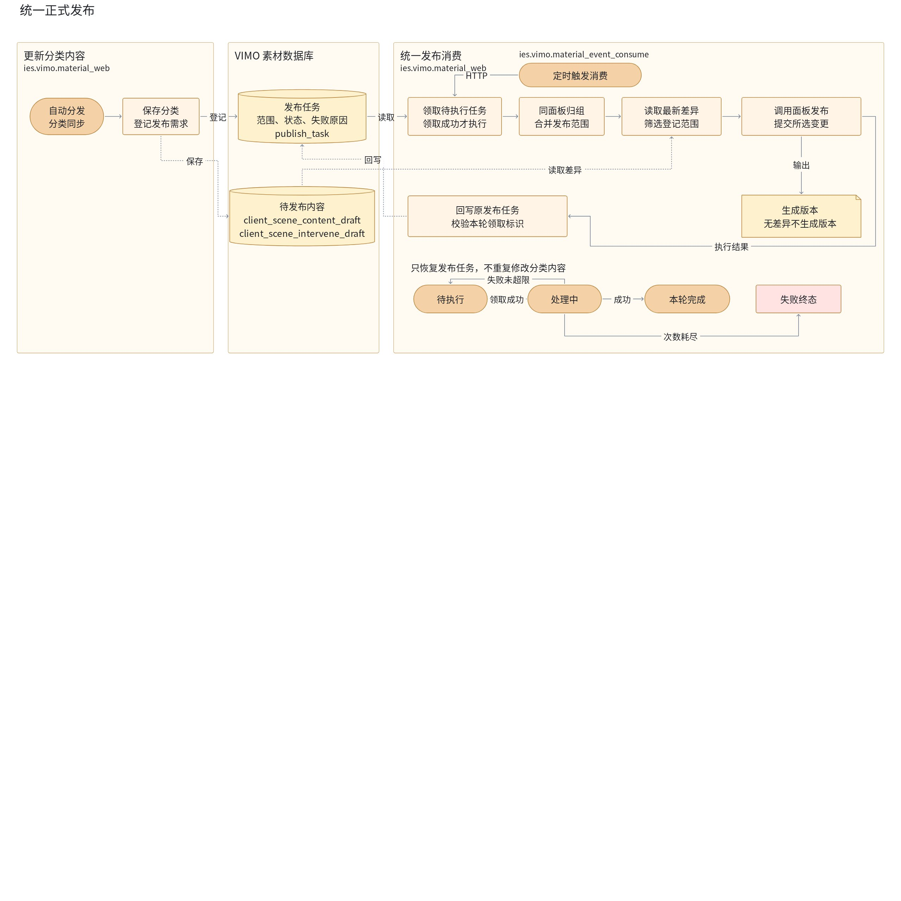
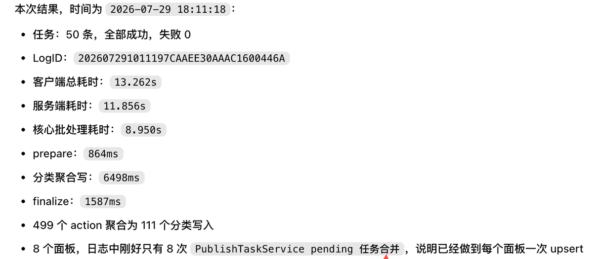
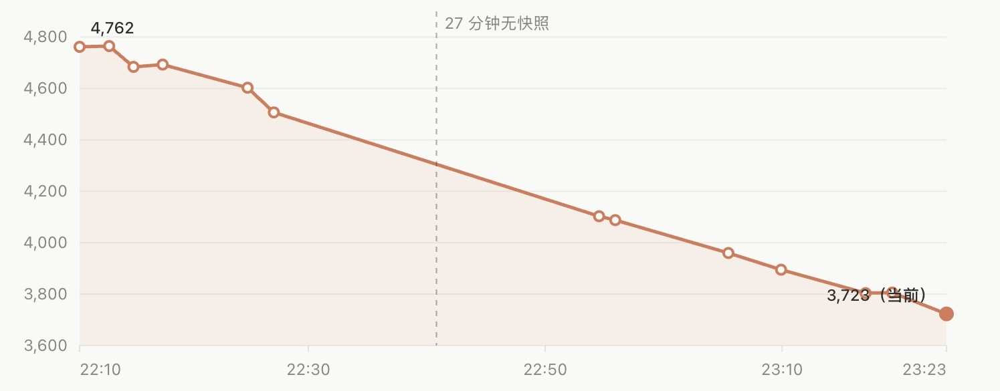
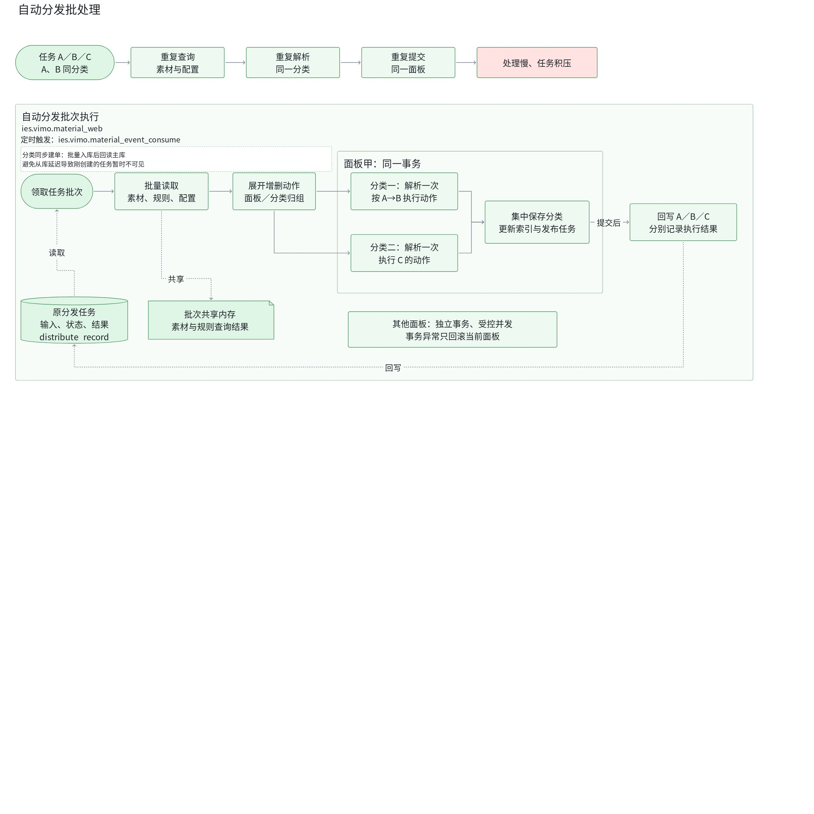

# 4.  重点工作 - 完善素材自动供给

<!-- 正式文档：https://bytedance.larkoffice.com/wiki/GMEcwktLQip6NhkoYmHcL02Tnqg；本模块标题块：AQZedfwGRoqIApxkrHCcrRDtnnk。后续同步只更新正式文档的对应章节。 -->

## 4.1 背景

图片编辑器的文字模板供给有限，需要将视频侧动态模板转为静态复用。我负责 VIMO 侧的<b>自动入面板与发布接入</b>，并优化多个供给场景共用的发布调度和批量处理，扩大图片侧供给、缩短素材上线等待。

## 4.2 技术设计

【三列表：543,543,512】

【第一列】

<b>建设图片模板自动供给</b>

<b>背景</b>

视频模板完成转静和审核后，还需要同步到图片面板并正式发布，用户才能使用。将这两步自动化，可以减少运营逐批同步、发布的操作，让新增模板持续进入图片场景。

【双栏：0.415058,0.584942】

【左栏】

【右栏】

【/双栏】

<b>方案</b>

1. 转静结果与审核结果可能先后到达。监听素材变更时，同时检查两项状态，仅在“产物就绪且图片审核通过”由未满足变为满足时触发同步，避免因到达顺序不同而遗漏模板。
2. 按配置的视频与图片分类对应关系，将合格模板加入图片面板，并登记发布任务，由现有发布服务完成正式发布。

【飞书画板：图片模板供给流程】

[编辑画板](https://bytedance.larkoffice.com/wiki/GMEcwktLQip6NhkoYmHcL02Tnqg#WvSBdp9QfobF2jxxIolcbmuNnOb)

【/飞书画板】

<b>产出</b>

- 为图片场景补充模板约 <b>3.09 万条</b>。
- 实现首次分发、分类变更、面板同步和动转静同步四类场景的自动供给可视化，帮助运营<b>核对新增素材数量与去向</b>。

【第二列】

<b>统一正式发布</b>

<b>问题</b>

原自动发布逐一扫描全部面板，对比待发布内容与正式版本，一轮约 30 分钟；有变更的面板只有被扫描到后才会发布。

自动分发与分类同步分别维护发布逻辑，失败后需要确认内容更新和正式发布各自完成到哪一步，才能确定重试范围。

【双栏：0.551331,0.448669】

【左栏】

【右栏】

【/双栏】

<b>方案</b>

1. 自动分发和分类同步在内容更新时登记面板发布任务，由同一定时器合并同面板需求，再调用现有发布服务。
2. 普通分发将分类内容和发布任务在同一事务内提交；分类同步先在事务内保存内容与执行结果，再创建发布任务，创建失败时依据结果补建。
3. 内容更新与正式发布分别记录结果，发布失败只重试发布。 发布任务通过条件更新领取，只有领取成功的实例执行；超时任务重新调度，失败任务保留原因并有限重试。

【飞书画板：正式发布改造前后对照】

[编辑画板](https://bytedance.larkoffice.com/wiki/GMEcwktLQip6NhkoYmHcL02Tnqg#Q3DWdXBlqoosw4x1BnocqtXankg)

【/飞书画板】

<b>产出</b>

- 待发布面板直接进入任务调度，<b>省去全量扫描等待</b>；同面板多次变更合并发布，减少重复发布。
- 发布失败可追溯到具体任务和原因，并<b>独立重试</b>，无需重新执行已完成的分类更新。

【第三列】

<b>优化素材入面板性能</b>

<b>问题</b>

素材入面板按任务逐条处理，同批任务会反复读取素材与配置、修改相同分类和面板。重复读写拉长单批耗时，消费跟不上新增时，任务积压进一步延迟素材上线。

【双栏：0.475323,0.524677】

【左栏】

【右栏】

【/双栏】

<b>方案</b>

分类同步先按批次计算和创建任务，减少逐条建单的开销；素材所属分类没有变化时，不再创建分发任务，避免无效任务占用处理能力。

进入执行阶段后，再按数据的共享范围组织同批任务，减少重复读写：

1. 整批读取素材、分发规则和面板分类配置，供各任务共享，减少重复查询。
2. 同一分类的素材列表只解析一次，增删操作在内存中按原任务和操作顺序执行，得到最终列表后一次写回，减少重复解析和写入，同时保持素材排列不变。
3. 同一面板的分类修改在一个事务内提交，不同面板受控并发；单面板失败独立回滚，执行结果仍关联原任务。

【飞书画板：批量执行优化对照】

[编辑画板](https://bytedance.larkoffice.com/wiki/GMEcwktLQip6NhkoYmHcL02Tnqg#I41hdQO2YoLoq4xBB3cchgnkndh)

【/飞书画板】

<b>产出</b>

- 素材入面板的批次处理耗时，优化前约 <b>1,188 秒</b>，优化后约 <b>12 秒</b>。
- 每轮分发任务处理量从 <b>20 条增至 300 条</b>，扩大至原来的 <b>15 倍</b>，缓解任务积压造成的素材上线延迟。

【/三列表】

## 4.3 未来规划

- <b>可靠性治理</b>：将任务追踪与自动恢复覆盖到素材同步、入面板和正式发布全过程，支持中断后接续执行，减少人工查单和补发。

## 4.4 相关文档

- [【CapCut】图片场景文字模板补供给-动转静](https://bytedance.larkoffice.com/docx/YrWYdxzPUonH9ExEIzHc0a22ndf)
- [【技术方案】自动分发、同步统一正式发布](https://bytedance.larkoffice.com/wiki/D5gTwDx9li9VUXkbImKcjTKon7b)
- [【技术方案】优化自动分发链路](https://bytedance.larkoffice.com/wiki/K395wkrvuiUXtkkwpevcNjKunTg)
- [自动分发任务消费性能分析与批次重构方案](https://bytedance.larkoffice.com/docx/SEVMdvrDKopRMLxckFncGNaRnZd)
- [【自测文档】自动分发、同步统一正式发布](https://bytedance.larkoffice.com/wiki/Cijww3zcmiDfRnkCN75cNNU3nVh)
- [自动化链路技术优化](https://bytedance.larkoffice.com/docx/M01hdOxyboo5mQxW0POcOPOsn8d)
- [周报](https://bytedance.larkoffice.com/wiki/RJnKwYTaUiuc4wkmL4FcnPdEnzf#Or65dcOyCo8z41xI1oDcYQwSnof)：9 月第四周存量补齐记录。

供给统计消息：[7 月增量自动供给记录](https://applink.feishu.cn/client/chat/open?openChatId=oc_49d89f23f5aad895d44b4a8470e654ad&position=582)。
