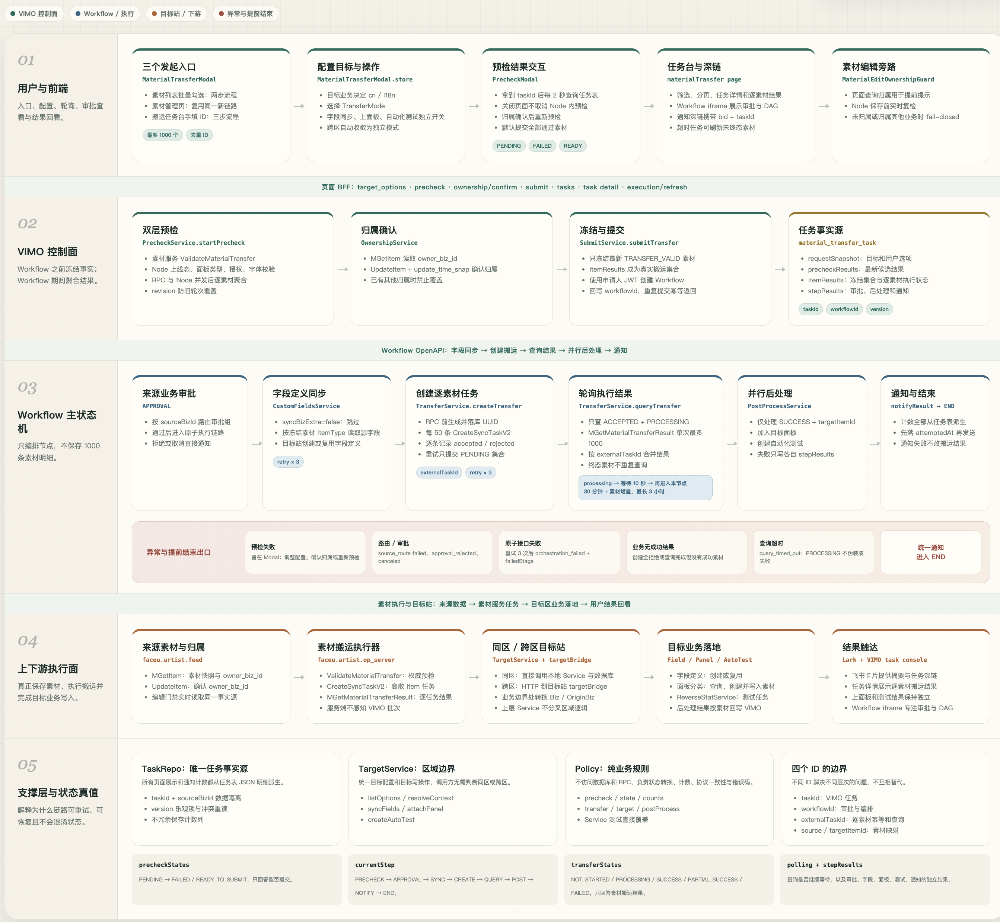
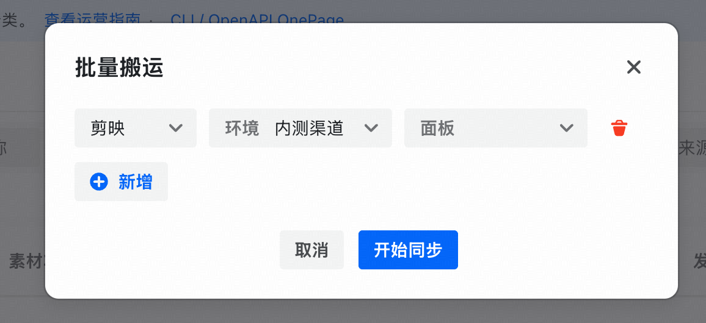
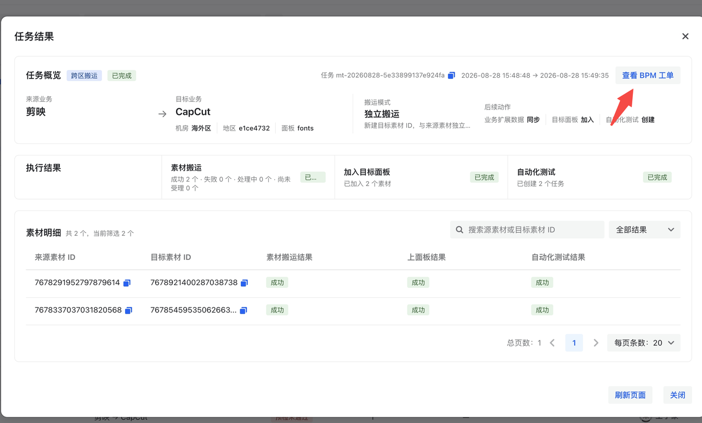
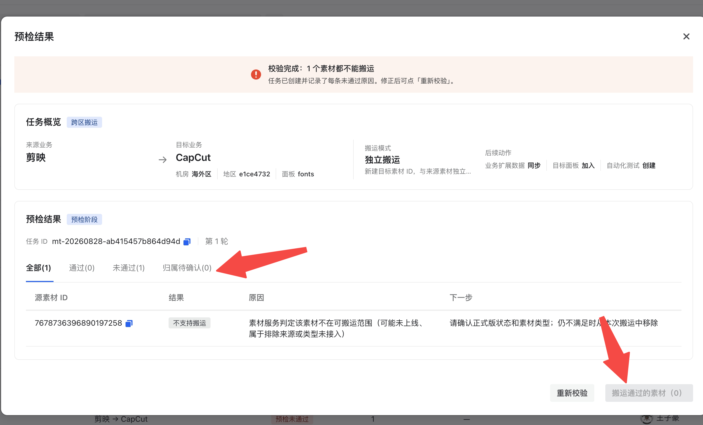
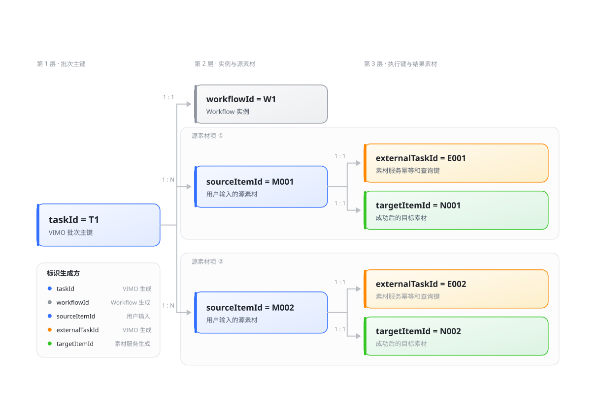
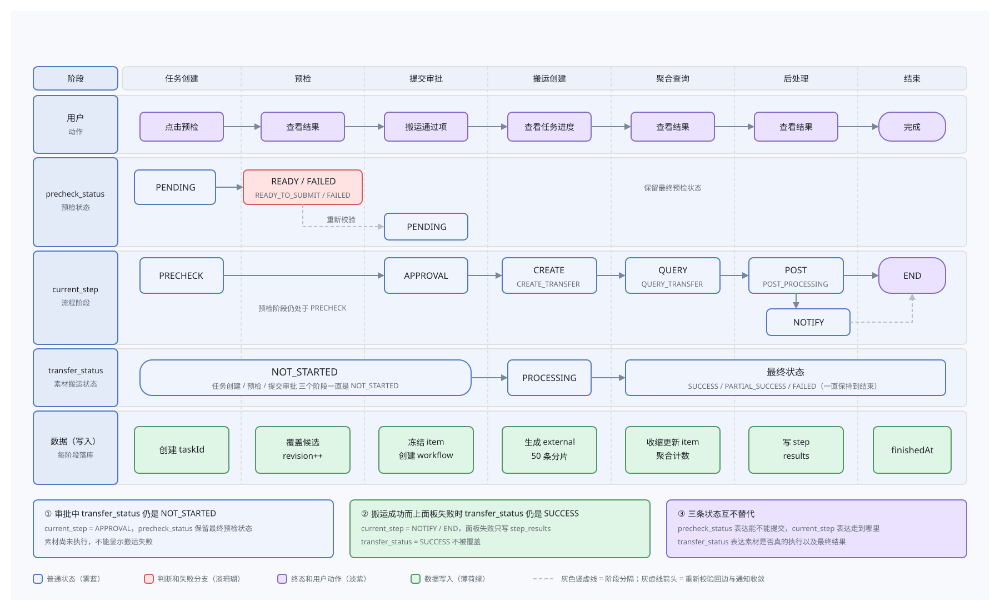
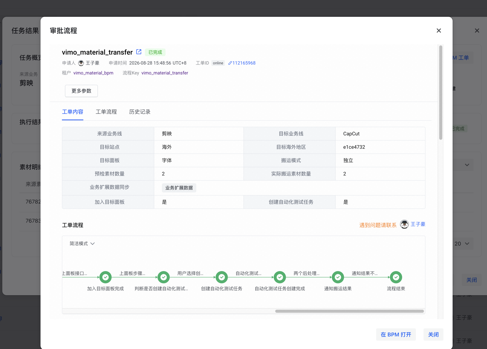
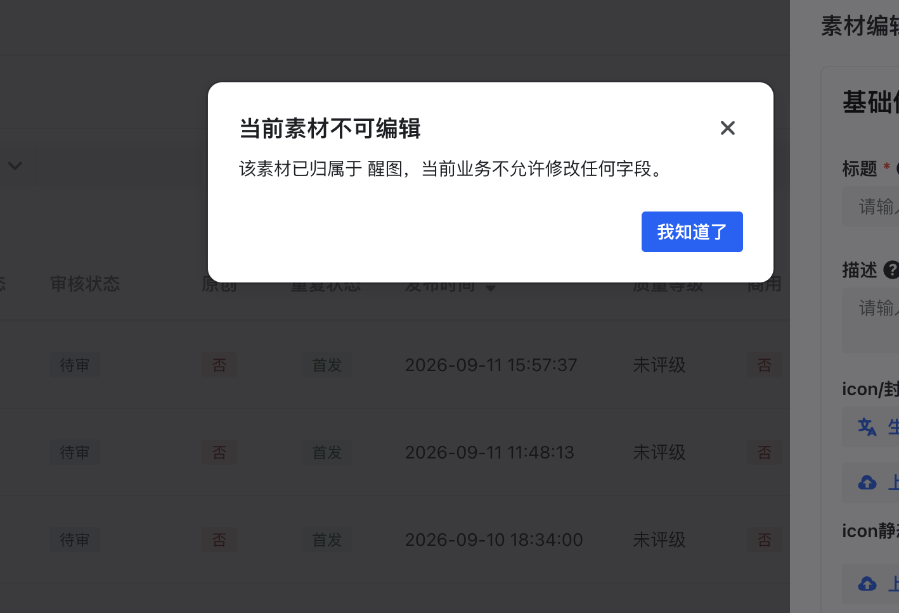
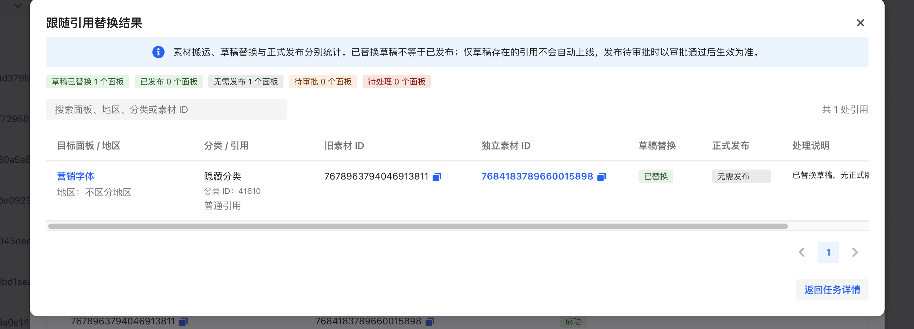

# 3 全球搬运

## 3.1 背景

剪映、CapCut、醒图和 Hypic 需要跨业务、跨地区复用已有素材，补充高价值内容供给。例如，剪映希望引入 CapCut、醒图的人像效果，CapCut 希望复用 Hypic 的优质效果；同一业务也需要将已有素材用于海外、图片编辑或 Live 等场景。

原有工具已经支持跨区搬运，但仍有三项缺口：

<ul><li>场景覆盖不全：缺少同区搬运，无法统一承接跟随使用和独立维护的需求。</li>
<li>执行过程难追踪：没有任务列表，申请人与目标面板等信息未持久化；流程中断后，难以确认已完成的素材和剩余操作。</li>
<li>维护边界不清楚：多个业务共用素材时，一方的编辑或下架会影响其他使用方，需要明确谁能维护、谁能使用。</li>
</ul>

本次沿用素材服务的复制与关系管理能力，由 VIMO 补齐同区场景，串起申请、审批、执行和结果查询，并将归属规则接入素材编辑与面板选材。首期优先承接无需改包的素材。

<cite doc-id="BvITwxkBAiBz1gke3eQcWmsSniI" file-type="wiki" title="【VIMO-PRD】素材全球互通" type="doc"></cite> <cite doc-id="YJRKwUuWNi2jBpkPks3cwxkKnvh" file-type="wiki" title="全球素材互通-搬运指南" type="doc"></cite>

## 3.2 产出

【高亮块】
<ul><li>首批供给：已确定向 CapCut 搬运画面特效、转场、字体 <b>3 类共 250 个素材</b>，用于补充目标业务缺少的内容。<a href="https://bytedance.larkoffice.com/wiki/VMrVwwfcgitcPokrU5McHnSwnjf">搬运清单</a></li>
<li>操作体验：新增同区搬运，提交后无需停留页面；任务台统一展示进度、逐素材结果及面板／测试结果，<b>异常可定位到素材和步骤</b>。</li>
<li>归属治理：将维护权限与共享使用分开，支持归属确认、跨业务编辑拦截和旧引用替换。</li>
<li>方案沉淀：沉淀通用 BPM 流程接入方案，已在数字资产开白接入，<b>节省研发约 2 人日</b>。</li>
</ul>

【/高亮块】

## 3.3 技术设计

<table><colgroup><col width="960"/></colgroup><tbody><tr><td vertical-align="top">
<b>系统分工</b>：VIMO 保存申请与执行记录，BPM 推进审批和执行节点；素材服务完成复制并维护归属关系。复制完成后，由目标站点 VIMO 处理字段、面板和测试配置，同区在本地执行，跨区调用目标站点接口。

</td></tr>
</tbody>
</table>
<table><colgroup><col width="480"/><col width="480"/></colgroup><thead><tr><th background-color="rgba(245,246,247,0.9)" vertical-align="top">
管理搬运任务

</th><th background-color="rgba(245,246,247,0.9)" vertical-align="top">
管理素材归属

</th></tr>
</thead>
<tbody><tr><td vertical-align="top">
<b>难点</b>

申请要经过人工审批，执行时必须仍对应审批的那批素材。批量调用可能只受理一部分，或者执行后没有返回响应；此时整批重跑可能重复创建，直接判失败又会遗漏已经完成的素材。

素材复制、上面板和测试还各有结果，不能归为一个成功或失败。轮询与后处理同时回写时，也需要保留彼此的进展。

</td><td vertical-align="top">
<b>难点</b>

共用素材时，一方编辑或下架会影响其他业务，已有 CapCut 误下架 Pippit 素材的情况。需要限制维护权，又不能阻断正常共享使用。

历史素材还可能缺少归属；转独立后，新素材已生成，面板却仍引用旧 ID。管理规则必须同时兼容新操作和已有内容。

</td></tr>
<tr><td vertical-align="top">
<b>平台效果</b>

<b>改造前</b>：从弹窗选择目标并发起同步。

<b>改造后</b>：在任务详情回查每个素材及后续步骤。

<blockquote>
【待截图：补充部分失败的真实任务详情，保留失败素材、步骤原因及日志入口，证明异常可以定位。】

</blockquote>

<b>解决方案</b>

<ul><li><b>固定执行依据</b>：将申请配置和执行记录保存在 <code>material_transfer_task</code> 数据表，提交时固定预检通过的素材范围。BPM 后续节点通过整批任务编号 <code>taskId</code> 读取同一份申请，避免重复传递整批参数，也保证执行范围与审批范围一致。</li>
</ul>
<blockquote>
【画板占位｜搬运业务流程】

类型：业务流程图。申请人选材与配置 → VIMO 预检并固定通过项 → 人工审批 → 准备目标字段 → 搬运与查询 → 对成功项上面板／建测试 → 通知结果。审批拒绝则结束。

</blockquote>

<ul><li><b>恢复中断任务</b>：请求超时后，不能确认素材服务是否已经受理。为此，调用前就为每个素材保存稳定执行编号 <code>externalTaskId</code>，再分批记录受理结果。未确认受理项用原编号重试，已受理项继续查询，不因整批重跑而丢失已有进展。</li>
</ul>
<blockquote>
【画板占位｜批量执行恢复】

类型：局部时序图。VIMO → 任务主库：保存执行编号；VIMO → 素材服务：分批提交。响应未知时保留待确认记录，重试复用原编号；已受理素材进入结果查询。

</blockquote>

任务与执行标识：一张申请关联多个素材，每个素材保留自己的执行编号

<ul><li><b>分开管理状态</b>：流程等待超时，素材仍可能在执行；素材已搬运成功，上面板也可能失败。因此分别保存流程、逐素材执行和后处理结果。超时后继续查询素材进度，后处理失败保留已生成的目标素材，不将整批任务统一判为搬运失败。</li>
</ul>

任务状态：预检、流程阶段与搬运结果分别记录

<ul><li><b>保留并发进展</b>：轮询与后处理可能基于同一份旧记录同时写回，整条覆盖会丢掉另一方的更新。状态判断读取主库；写入遇到版本冲突就重读并合并本次变化。多个任务向同一面板追加素材时，在事务内锁定面板后合并，保留其他任务已加入的内容。</li>
</ul>

<b>沉淀流程接入方案</b>

后续需求同样需要“审批通过后执行”。将建单、查询、身份处理封装，并保留审批分支与业务节点的配置范例，新场景可直接沿用接入方式。相较于分别补审批字段、维护回调和连接 FaaS，BPM 用工单保存流程信息、用节点调用业务接口，减少重复接入；各场景仍维护自己的业务数据与规则。

</td><td vertical-align="top">
<b>解决方案</b>

<ul><li><b>分开判断使用与维护</b>：VIMO 的归属规则服务 <code>MaterialAccessService</code> 统一读取素材服务返回的字段：<code>owner_biz_id</code> 确定谁能维护，<code>redirect_item_id</code> 标识当前业务应使用的新素材。非归属业务不能修改；已被替代的旧素材不再出现在新增选材中，历史引用仍按原 ID 读取。</li>
</ul>
<blockquote>
【画板占位｜素材归属控制】

类型：分层技术架构图。页面／OpenAPI → 搜索、选材、维护、历史读取入口 → MaterialAccessService 规则服务 → Feed 归属数据。owner_biz_id 用于维护校验，redirect_item_id 用于旧素材新增使用限制；历史读取保留原 ID。

</blockquote>
<ul><li><b>统一执行写前校验</b>：页面打开后归属仍可能变化，仅靠置灰不足以保护写入。编辑、上下线和面板写入口共用校验，写前重新查询；查询失败停止写入，历史读取、移除和内部替换按各自规则处理。</li>
</ul>

<b>归属已确定</b>：使用方不能修改归属其他业务的素材。

<ul><li><b>补齐缺失归属</b>：历史素材缺少归属时，从同区候选业务中确认。两个人同时确认可能相互覆盖，因此写前重读归属，并携带更新时间快照校验：同值重试直接成功，异值冲突拒绝覆盖；批量结果逐项返回，失败项可单独处理。</li>
</ul>

<b>归属待确认</b>：补齐维护责任后继续操作。

【待截图：同区候选业务与批量逐项确认结果，展示归属确认入口及冲突反馈。】

<blockquote>
【画板占位｜素材归属确认】

类型：局部时序图。操作界面 → 归属确认服务 → Feed：读取最新归属、校验同区候选、携带更新时间快照写入、返回逐项结果。展示同值幂等、异值冲突和部分失败三种分支。

</blockquote>
<ul><li><b>保留后续操作入口</b>：归属不明时引导确认，已转独立时提供新素材入口。原窗口接管的交互优化（开发中）保留未提交表单，确认后由用户重新提交，避免自动重放写操作。</li>
</ul>

【待截图：开发分支的原窗口接管交互，展示确认归属后表单仍保留、由用户重新提交。】

<ul><li><b>保护已有面板内容</b>：转独立生成新素材后，面板仍可能引用旧 ID。仅替换成功搬运的素材，并检查面板有无并发修改。发布前，用线上内容生成“仅替换引用”的预期结果，与待发布内容完整比对；包含其他未发布改动时停止自动发布，避免把运营草稿一并上线。</li>
</ul>

<b>跟随转独立的引用替换</b>

<blockquote>
【画板占位｜旧引用替换】

类型：局部时序图。搬运入口 → 替换服务 → 面板数据库 → 发布服务：读取成功映射、检查面板变化、事务内替换并保存回执、比对预期发布内容、发布后回读。只有草稿引用则无需发布；包含其他改动则停止自动发布；发布响应未知先回读。

</blockquote>

</td></tr>
</tbody>
</table>

## 3.4 未来规划

下一步扩展可搬运内容，减少改包、配置和选材中的人工介入。以下为拟定的试点目标。

<table><colgroup><col width="180"/><col width="390"/><col width="390"/></colgroup><thead><tr><th background-color="rgba(245,246,247,0.9)" vertical-align="top">
方向与问题

</th><th background-color="rgba(245,246,247,0.9)" vertical-align="top">
建设内容

</th><th background-color="rgba(245,246,247,0.9)" vertical-align="top">
阶段目标

</th></tr>
</thead>
<tbody><tr><td vertical-align="top">
同步商业化信息

素材搬入后，付费配置仍需按目标业务补齐。

</td><td vertical-align="top">
与业务确定可迁移字段和目标付费策略，接入目标配置步骤；不兼容项单独返回，避免直接照搬来源配置。

</td><td vertical-align="top">
先覆盖剪映 → CapCut 1 条链路；支持范围内的字段自动配置，逐素材人工补录降为 0，逐项核对目标策略。

</td></tr>
<tr><td vertical-align="top">
接入素材改包

一期优先搬运无需改包的素材，需要格式或效果适配的内容仍依赖人工。

</td><td vertical-align="top">
与 IE／设计选择高价值品类，沉淀通用改包脚本，接入可用性测试；无法自动处理的任务转人工后继续流转。

</td><td vertical-align="top">
先打通 1 类素材、沉淀 1 套规则；纳入试点的素材全部完成端上测试。记录每百个素材的人工工时，与改包前对比。

</td></tr>
<tr><td vertical-align="top">
支持 AI 自助选材

当前候选取数、去重和清单整理仍需要研发介入。

</td><td vertical-align="top">
封装取数、去重和清单预检工具，由自然语言生成候选；业务确认范围后接入已有审批与搬运流程。

</td><td vertical-align="top">
先覆盖 1 组常用筛选条件；业务可自主生成搬运清单，标准取数的研发介入次数降为 0。

</td></tr>
</tbody>
</table>
